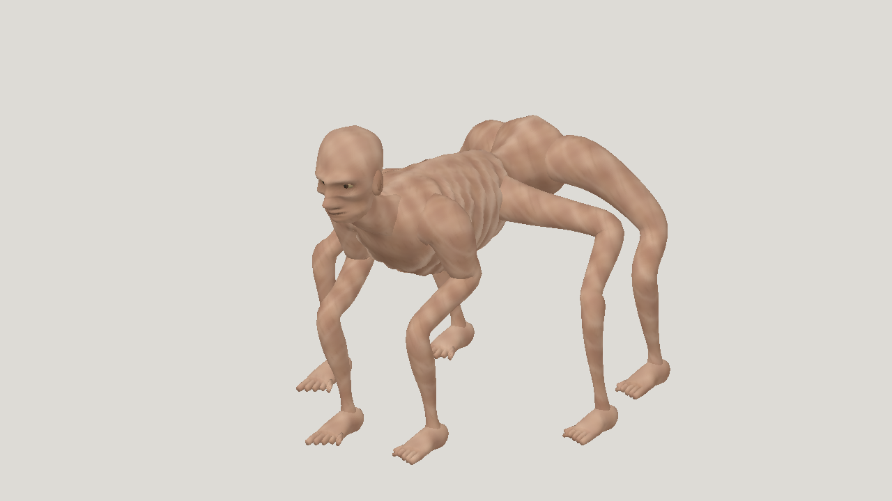

# Six-limbed horror · GPT-6.2 Sol high

| Measure | Value |
|---|---|
| Model | GPT-6.2 Sol high |
| Driver | Codex |
| Effort | high |
| Scope | Fresh v8 reference trial. Five submitted static evaluations, three of three native rig builds held the contract, and three game proposals. |
| Completed | unknown |
| Evaluations | 5 |
| Runtime seconds | unknown |
| Driver turns | unknown |
| Prompt tokens | unknown |
| Cached prompt tokens | unknown |
| Cache write tokens | unknown |
| Completion tokens | unknown |
| Reasoning tokens | unknown |
| Model calls | unknown |
| Cost USD (unavailable) | unknown |
| Numeric score | 0.501 |
| Gates passed | 0 |
| Gates total | 1 |

Token counts use the report's provider conventions. Reasoning is included in completion tokens; cache counters are not extra prompt tokens. Estimated cost is not an invoiced charge.

The selected static model scored 0.5010. Measured resemblance was 0.353 against the 0.40 gate. The numeric leader scored 0.5057.

Sprint and Leap passed the native rig contract. The leap travels 0.90 m forward.

Experimental terrain shows the second game proposal. Sprint slip reached 0.361 m/s with IK off and 0.372 m/s on flat ground and the cross-slope against the 0.35 m/s limit. The obstacle stress scene also shows penetration and abrupt joint motion.

Codex subscription usage and cost are unavailable.

[Download selected model](model-01.glb)

[Download selected model](model-02.glb)
