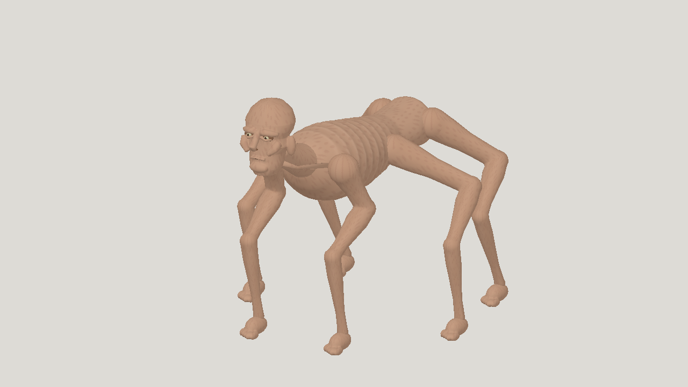

# Latest textured horror: Astra high

| Measure | Value |
|---|---|
| Model | gpt-6-astra |
| Driver | Codex native subscription |
| Effort | high |
| Scope | One independent five-evaluation static run, selected geometry and animation; all four clips included. Completed protocol, not production quality. |
| Completed | true |
| Evaluations | 5 |
| Runtime seconds | unknown |
| Driver turns | unknown |
| Prompt tokens | unknown |
| Cached prompt tokens | unknown |
| Cache write tokens | unknown |
| Completion tokens | unknown |
| Reasoning tokens | unknown |
| Model calls | unknown |
| Cost USD (unavailable) | unknown |
| Numeric score | 0.4707 |
| Gates passed | 0 |
| Gates total | 1 |

Token counts use the report's provider conventions. Reasoning is included in completion tokens; cache counters are not extra prompt tokens. Estimated cost is not an invoiced charge.

Five successful static evaluations and three passing rig candidates. Visual selection scores 0.4707; numeric best is 0.4726. All five miss resemblance 0.40.

28 bones and one 1024 px script-painted texture. Idle, crawl, gentle_turn and sprint pass declared rig gates. Sprint worst edge is 2.455 against the 2.5 limit.

Prototype clay-like anatomy, shoulder seams and joint pinching remain. In-place crawl slides about 122 mm per foot per cycle; sprint about 282 mm. Sprint is a faster scuttle with shallow nominal flight.

[Download selected model](model-01.glb)
