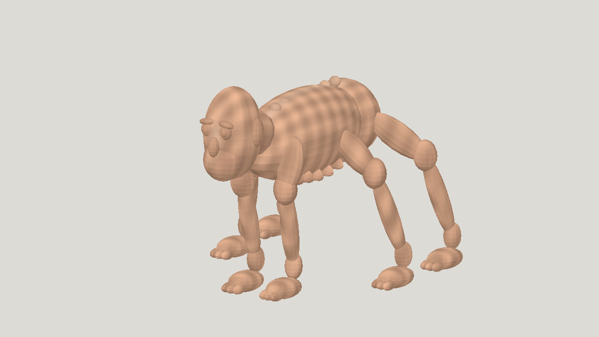

# Latest textured horror: Luna high

| Measure | Value |
|---|---|
| Model | gpt-6-luna |
| Driver | Codex native subscription |
| Effort | high |
| Scope | One independent five-evaluation static run, selected geometry and animation; all four clips included. Completed protocol, not production quality. |
| Completed | true |
| Evaluations | 5 |
| Runtime seconds | unknown |
| Driver turns | unknown |
| Prompt tokens | unknown |
| Cached prompt tokens | unknown |
| Cache write tokens | unknown |
| Completion tokens | unknown |
| Reasoning tokens | unknown |
| Model calls | unknown |
| Cost USD (unavailable) | unknown |
| Numeric score | 0.4084 |
| Gates passed | 0 |
| Gates total | 1 |

Token counts use the report's provider conventions. Reasoning is included in completion tokens; cache counters are not extra prompt tokens. Estimated cost is not an invoiced charge.

Five successful static evaluations in six submissions, then three passing rigs in four submissions. Selected geometry scores 0.4084; latest scores 0.3889. All static candidates miss resemblance 0.40.

24 bones and one 1024 px script-painted texture. Selected rig passes idle, crawl, gentle_turn and sprint limits, with about 6.7 mm maximum sampled ground drop against 8 mm allowed.

Primitive capsule-like anatomy and moving-part joint gaps remain. Rigid single-bone skinning, in-place treadmill gait and a restrained faster sprint are not realistic full-body locomotion. Foot locking was visually reviewed, not quantitatively certified.

[Download selected model](model-01.glb)
