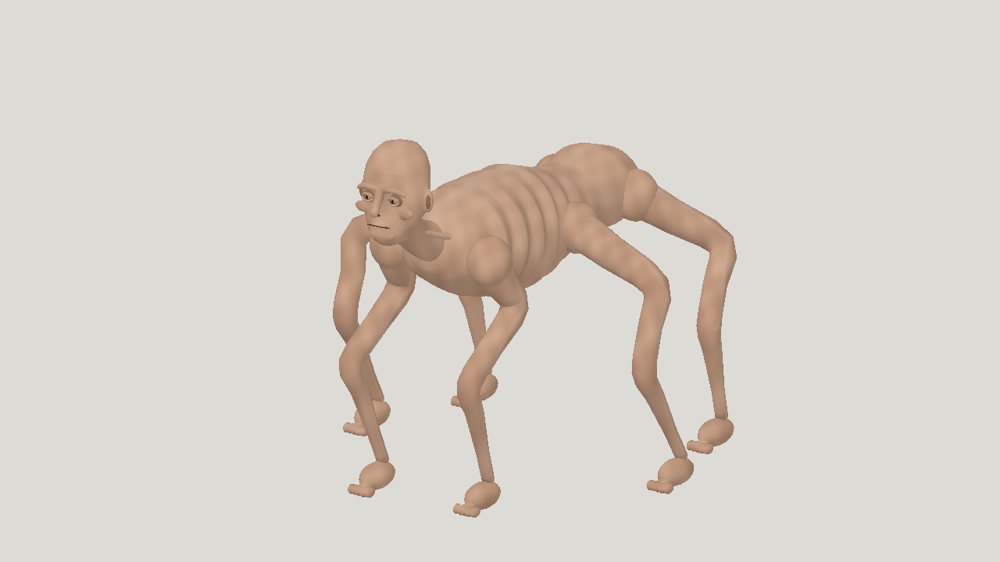

# Latest textured horror: Sol high

| Measure | Value |
|---|---|
| Model | gpt-6.1-sol |
| Driver | Codex native subscription |
| Effort | high |
| Scope | One independent five-evaluation static run, selected geometry and animation; all four clips included. Completed protocol, not production quality. |
| Completed | true |
| Evaluations | 5 |
| Runtime seconds | unknown |
| Driver turns | unknown |
| Prompt tokens | unknown |
| Cached prompt tokens | unknown |
| Cache write tokens | unknown |
| Completion tokens | unknown |
| Reasoning tokens | unknown |
| Model calls | unknown |
| Cost USD (unavailable) | unknown |
| Numeric score | 0.4369 |
| Gates passed | 0 |
| Gates total | 1 |

Token counts use the report's provider conventions. Reasoning is included in completion tokens; cache counters are not extra prompt tokens. Estimated cost is not an invoiced charge.

Five successful static evaluations and three passing rig candidates. Visual selection, numeric best and latest all score 0.4369. All five miss resemblance 0.40.

29 bones and one 1024 px script-painted texture. Idle, crawl, gentle_turn and sprint pass declared rig gates. Original geometry, UVs, materials and embedded texture were preserved before sanitizing metadata.

Mannequin-like face, round feet and shoulder seams remain. In-place crawl slides about 146 mm per foot per cycle; sprint about 238 mm. Dense samples show 0.205 mm maximum ground penetration and under 0.8 percent whole-limb volume loss.

[Download selected model](model-01.glb)
