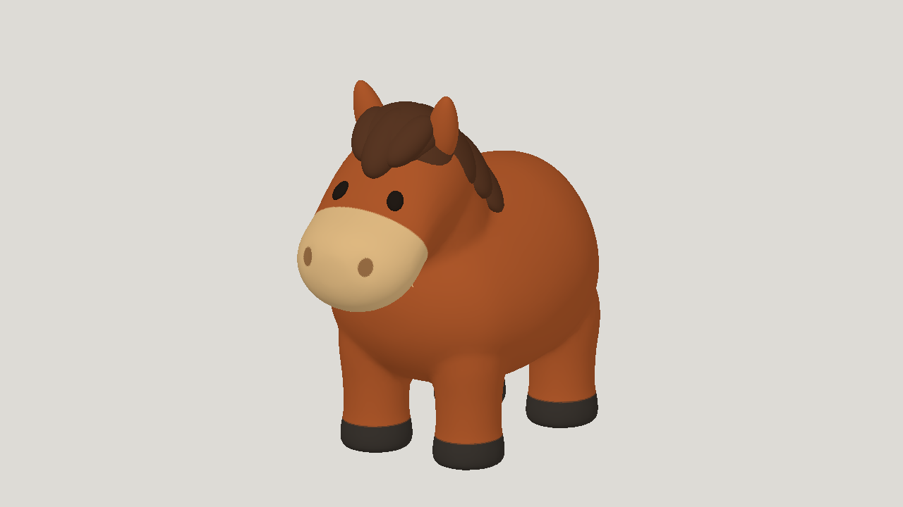
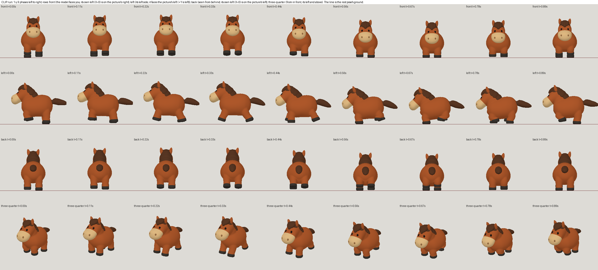
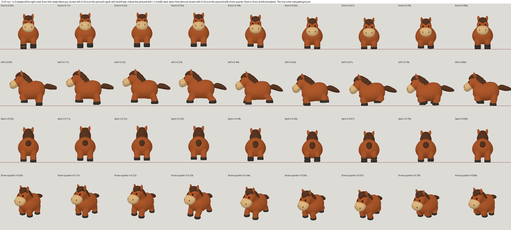
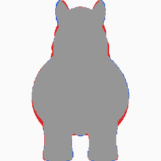

# GPT-6.2 Astra High horse

| Measure | Value |
|---|---|
| Model | gpt-6.2-astra |
| Driver | Codex subscription CLI |
| Effort | high |
| Scope | One independent High run. The fixed horse contract used a 25-build cap, patience of three and three consecutive unchanged ideation rounds. |
| Completed | true |
| Evaluations | 17 |
| Runtime seconds | 3310.261993 |
| Driver turns | 1 |
| Prompt tokens | 35053907 |
| Cached prompt tokens | 34839680 |
| Cache write tokens | unknown |
| Completion tokens | 61180 |
| Reasoning tokens | 19935 |
| Model calls | unknown |
| Cost USD (unavailable) | unknown |
| Numeric score | 0.8377 |
| Gates passed | 0 |
| Gates total | 0 |

Token counts use the report's provider conventions. Reasoning is included in completion tokens; cache counters are not extra prompt tokens. Estimated cost is not an invoiced charge.

Stopped at 17 of 25 scored builds after three unchanged ideation rounds. Three of 5 native rigs passed. The swept tail earned the visual pick and keeps the square stance. The gallop has clear suspension and hoof pitch. Jump dips 1.5 mm between keys.

The first two rigs exceeded the edge-stretch limit. The first also stretched too much surface during Run.

Image 01 is the selected model. Image 02 shows its Run clip. The remaining strips show Run in the rejected rig attempts, in submission order.

[Download selected model](model-01.glb)

[Download selected model](model-02.glb)

