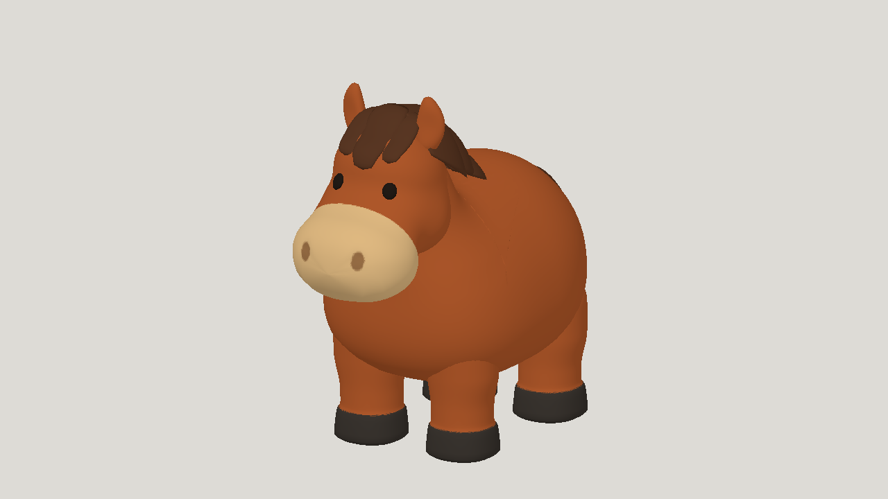
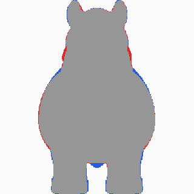

# Gemini 4 Carbon High horse

| Measure | Value |
|---|---|
| Model | gemini-4-carbon-high |
| Driver | Antigravity subscription CLI |
| Effort | high |
| Scope | One independent Antigravity High subscription run, with 5 scored models in 5 static submissions under the frozen 60,000-triangle horse contract. Runtime and recorded tokens cover the retry only. |
| Completed | false |
| Evaluations | 5 |
| Runtime seconds | 4061.582392 |
| Driver turns | 6 |
| Prompt tokens | 8008912 |
| Cached prompt tokens | 7416327 |
| Cache write tokens | unknown |
| Completion tokens | 219055 |
| Reasoning tokens | 130995 |
| Model calls | unknown |
| Cost USD (unavailable) | unknown |
| Numeric score | 0.8334 |
| Gates passed | 0 |
| Gates total | 0 |

Token counts use the report's provider conventions. Reasoning is included in completion tokens; cache counters are not extra prompt tokens. Estimated cost is not an invoiced charge.

The run produced a static model. No native rig was available. 0 of 1 rig submissions passed. The square-edged mane has a visible gap above the neck. The first rig script failed Python syntax validation before export. The worker stopped before it could revise the rig.

[Download selected model](model-01.glb)

