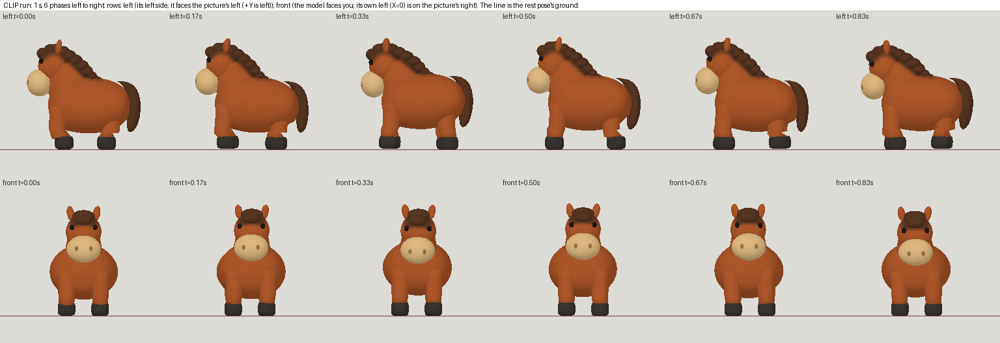
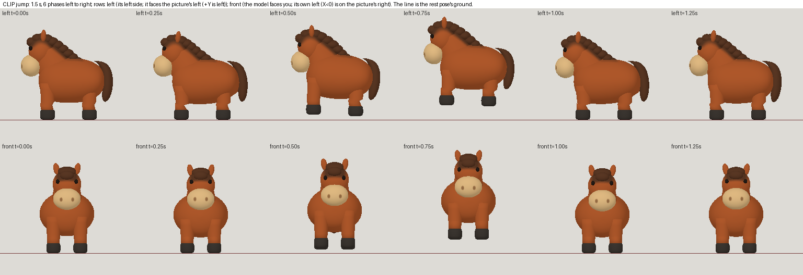

# DeepSeek V4.1 Flash 1017: horse

| Measure | Value |
|---|---|
| Model | deepseek/deepseek-v4.1-flash-1017 |
| Driver | mesh-jig API agent via OpenRouter |
| Effort | low |
| Scope | Rig and animation stage at low effort, six successful builds. Selected model from five visual iterations. Game stage separately tested at high effort. |
| Completed | true |
| Evaluations | unknown |
| Runtime seconds | 2783.1 |
| Driver turns | 48 |
| Prompt tokens | 2532251 |
| Cached prompt tokens | 2151424 |
| Cache write tokens | 0 |
| Completion tokens | 204101 |
| Reasoning tokens | unknown |
| Model calls | unknown |
| Cost USD (reported) | 0.125365 |
| Numeric score | 0.7483 |
| Gates passed | 0 |
| Gates total | 0 |

Token counts use the report's provider conventions. Reasoning is included in completion tokens; cache counters are not extra prompt tokens. Estimated cost is not an invoiced charge.

Separate muzzle and simplified mane/hooves. All five rig clips pass. Game preparation did not deliver: the jump lacks a measured landing stance. Native animation only; no accepted terrain package.

Total reported modelling, rig and game cost: US$0.507310482. Package token and runtime metrics describe the rig stage only.

One run per subject; selected visual model and highest numeric score may differ. No consumer-engine playtest.

[Download selected model](model-01.glb)
