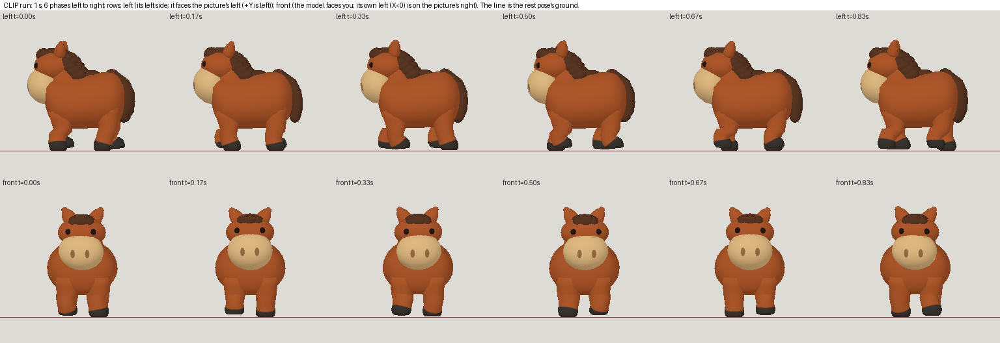
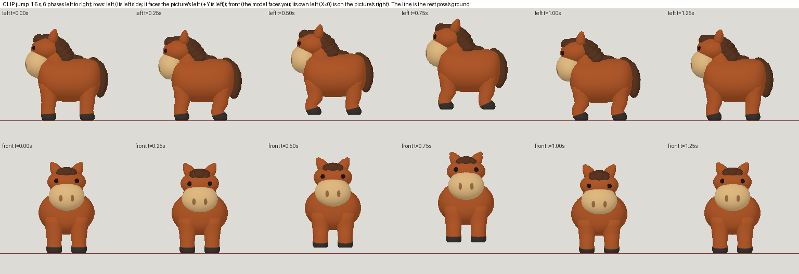

# DeepSeek V4.1 Flash 1017 high: horse

| Measure | Value |
|---|---|
| Model | deepseek/deepseek-v4.1-flash-1017 |
| Driver | mesh-jig API agent via OpenRouter |
| Effort | high |
| Scope | Final high-effort rig stage: 5 passing builds. Five reviewed modelling iterations across controlled continuations; game stage tested separately. |
| Completed | true |
| Evaluations | unknown |
| Runtime seconds | 3221.3 |
| Driver turns | 84 |
| Prompt tokens | 4134921 |
| Cached prompt tokens | 3333632 |
| Cache write tokens | 0 |
| Completion tokens | 462306 |
| Reasoning tokens | unknown |
| Model calls | unknown |
| Cost USD (reported) | 0.823264 |
| Numeric score | 0.6925 |
| Gates passed | 0 |
| Gates total | 0 |

Token counts use the report's provider conventions. Reasoning is included in completion tokens; cache counters are not extra prompt tokens. Estimated cost is not an invoiced charge.

Steered high-effort trial. Five native clips pass. Walk checks pass; run on a slope fails foot slip (0.70 m/s; limit 0.35). Terrain is diagnostic, not game-ready. Simplified mane and subdued gaits.

Total reported model, rig and game charges including failed attempts: US$2.654562826. Package tokens and runtime cover the final rig stage only.

The reply cap rose from 65536 to 100000 during the campaign. Process steering, restarts and a reasoning-state fix make this an exploratory trial, not a controlled effort ranking. No consumer-engine playtest.

[Download selected model](model-01.glb)
