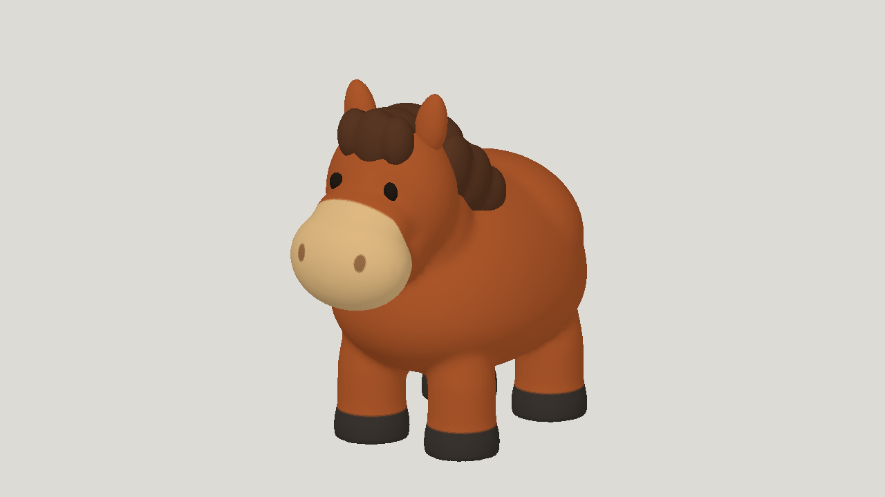

# Fable 5.2 low painted horse study

| Measure | Value |
|---|---|
| Model | Claude Fable 5.2 low |
| Driver | Claude Code subscription agent |
| Effort | low |
| Scope | One run, five static evaluations, one selected five-clip animated horse |
| Completed | true |
| Evaluations | 5 |
| Runtime seconds | unknown |
| Driver turns | unknown |
| Prompt tokens | unknown |
| Cached prompt tokens | unknown |
| Cache write tokens | unknown |
| Completion tokens | unknown |
| Reasoning tokens | unknown |
| Model calls | unknown |
| Cost USD (unavailable) | unknown |
| Numeric score | unknown |
| Gates passed | unknown |
| Gates total | unknown |

Token counts use the report's provider conventions. Reasoning is included in completion tokens; cache counters are not extra prompt tokens. Estimated cost is not an invoiced charge.

All use a 60,000-triangle cap, a script-painted 1024 px texture, and idle, walk, run, jump, rear_up. Costs and tokens not reported (subscription). This is a study with visible limitations, not a production-ready asset.

Selected static a05 scores 0.8240; numeric best of five is a04 at 0.8278. Motion judged by the builder from strips only; head smaller than the sheet.

[Download selected model](model-01.glb)
