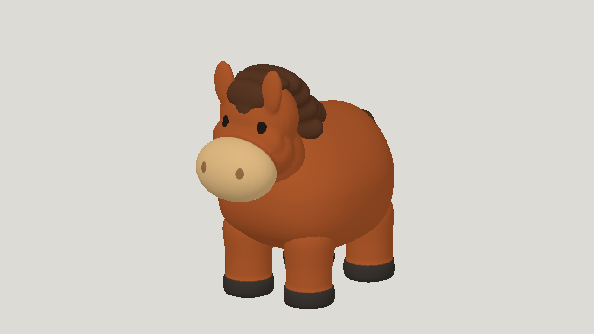

# Fable 5.2 medium horse with a gallop video reference, modelled, rigged and animated in one run

| Measure | Value |
|---|---|
| Model | Fable 5.2 medium |
| Driver | Claude Code subscription agent |
| Effort | medium |
| Scope | One run, five static evaluations, then five rig builds on the selected a05; five clips |
| Completed | true |
| Evaluations | 5 |
| Runtime seconds | 2152 |
| Driver turns | 147 |
| Prompt tokens | unknown |
| Cached prompt tokens | unknown |
| Cache write tokens | unknown |
| Completion tokens | unknown |
| Reasoning tokens | unknown |
| Model calls | unknown |
| Cost USD (estimated) | 9.4133306 |
| Numeric score | 0.8267 |
| Gates passed | 0 |
| Gates total | 0 |

Token counts use the report's provider conventions. Reasoning is included in completion tokens; cache counters are not extra prompt tokens. Estimated cost is not an invoiced charge.

Five-evaluation study, not a production-ready asset. The builder saw gallop frames from a local video model, then rigged and animated its own model in the same run (five rig builds; all five clips pass). Walk and run go forward. One hind hoof slides while planted in the run; run stretch 1.25%, worst edge 2.06x. One run, no blind review.

Builder shown six-view gallop frames generated by a local video model (MiniMax H3) from the horse sheet, plus a paragraph asking for legs and tail a rig can swing, and told to check the gait goes forward.

Selected a05 scores 0.8267, the best of five. 36 minutes and US$9.41 for the whole run, rig included (Claude Code notional estimate; subscription).

The builder rigged its own model: five rig builds, 22 bones. All five clips pass the contract; run stretch 1.25%, worst edge 2.06x.

Walk and run go forward. One hind hoof slides while planted in the run. Not blind reviewed.

[Download selected model](model-01.glb)
