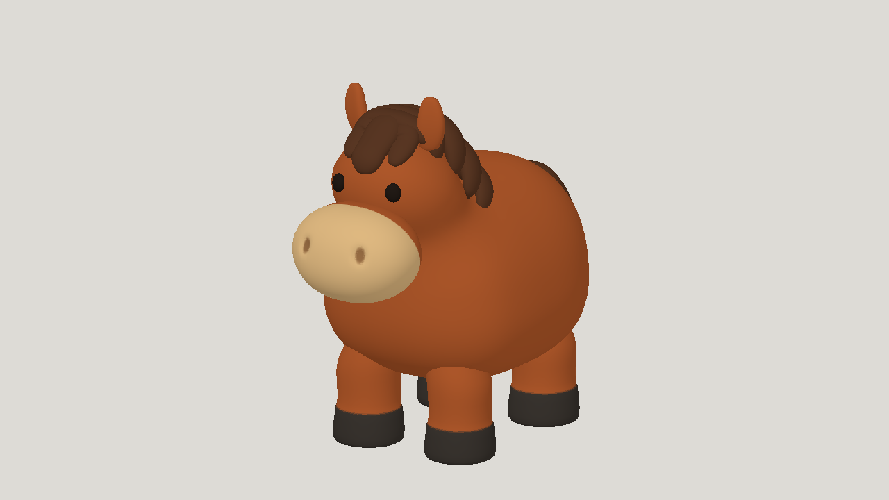
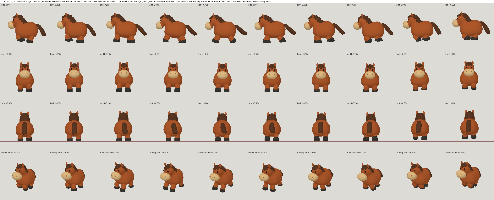
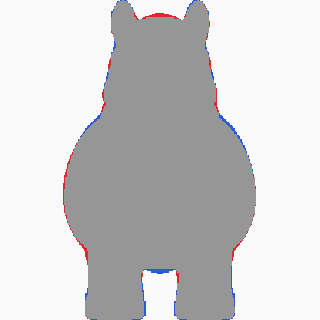

# Gemini 4 Neon High horse

| Measure | Value |
|---|---|
| Model | gemini-4-neon-high |
| Driver | Antigravity subscription CLI |
| Effort | high |
| Scope | One independent Antigravity High subscription run, with 5 scored models in 5 static submissions under the frozen 60,000-triangle horse contract. |
| Completed | false |
| Evaluations | 5 |
| Runtime seconds | 5332.434459 |
| Driver turns | 10 |
| Prompt tokens | 9848445 |
| Cached prompt tokens | 9138616 |
| Cache write tokens | unknown |
| Completion tokens | 350468 |
| Reasoning tokens | 185800 |
| Model calls | unknown |
| Cost USD (unavailable) | unknown |
| Numeric score | 0.8237 |
| Gates passed | 0 |
| Gates total | 0 |

Token counts use the report's provider conventions. Reasoning is included in completion tokens; cache counters are not extra prompt tokens. Estimated cost is not an invoiced charge.

The selected rig passed the native five-clip contract. 1 of 4 rig submissions passed. The walk takes short in-place steps. The run has a visible suspension phase, and the jump and rear are distinct. The worker stopped after this passing rig, before the planned revisions and final selection.

[Download selected model](model-01.glb)

[Download selected model](model-02.glb)

