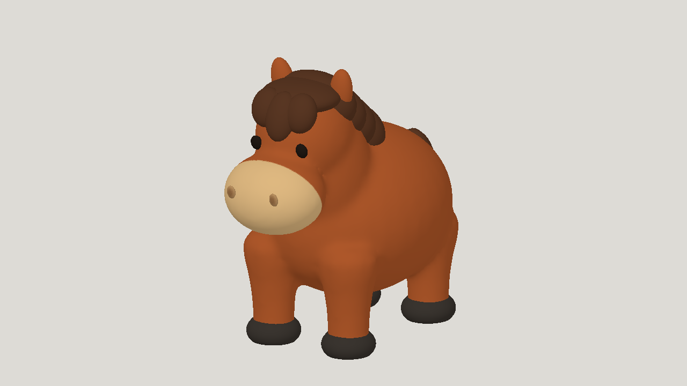
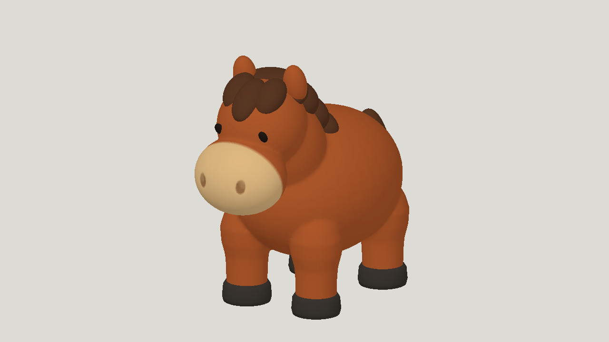
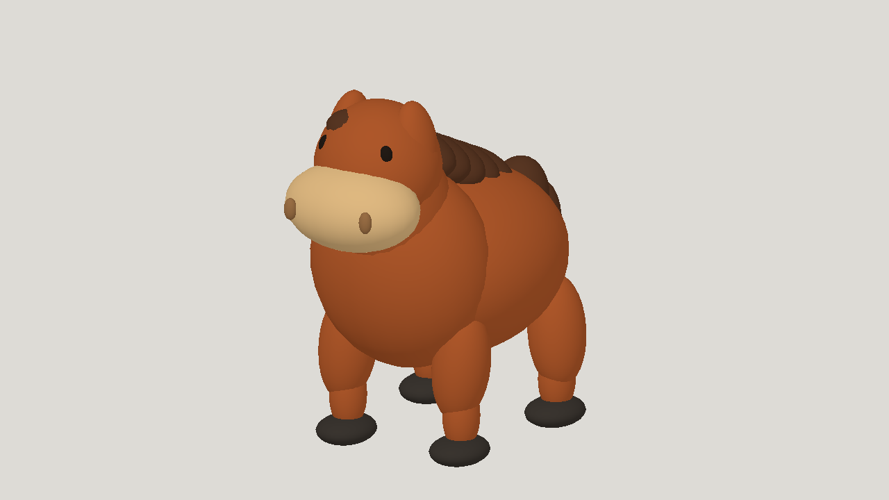

# Three high-effort painted horse studies

| Measure | Value |
|---|---|
| Model | GPT-6 Astra, GPT-6.1 Sol and GPT-6 Luna |
| Driver | Independent Codex subscription agents |
| Effort | high |
| Scope | Three runs, five static evaluations each, three selected five-clip animated horses |
| Completed | true |
| Evaluations | 15 |
| Runtime seconds | unknown |
| Driver turns | unknown |
| Prompt tokens | unknown |
| Cached prompt tokens | unknown |
| Cache write tokens | unknown |
| Completion tokens | unknown |
| Reasoning tokens | unknown |
| Model calls | unknown |
| Cost USD (unavailable) | unknown |
| Numeric score | unknown |
| Gates passed | unknown |
| Gates total | unknown |

Token counts use the report's provider conventions. Reasoning is included in completion tokens; cache counters are not extra prompt tokens. Estimated cost is not an invoiced charge.

Model/image order is Astra, Sol, Luna. All use a 60,000-triangle cap, a script-painted 1024 px texture, and idle, walk, run, jump, rear_up. Costs and tokens not reported (subscription). These are studies with visible limitations, not production-ready assets.

Model 01 and image 01: GPT-6 Astra high. Selected static score 0.7979; numeric best of five 0.7979. Simplified hair and hooves; local joint compression and 25.34% buried triangles. Six rig builds, three repaired failures. About 33 minutes observed, excluding initial orientation.

Model 02 and image 02: GPT-6.1 Sol high. Selected static score 0.8015; numeric best of five 0.8015. Shoulder bulges and faceting, simplified mane, shuffling walk and rigid rear balance. Three rig builds. About 32.2 minutes from directory records, excluding initial setup.

Model 03 and image 03: GPT-6 Luna high. Selected static score 0.6954; numeric best of five 0.7016. Detached-looking leg shapes, rigid-piece seams and sliding hooves; rear-up lifts the hind hooves about 46 mm. Five rig builds, two repaired ground-limit failures. Runtime not recorded.

[Download selected model](model-01.glb)

[Download selected model](model-02.glb)

[Download selected model](model-03.glb)
