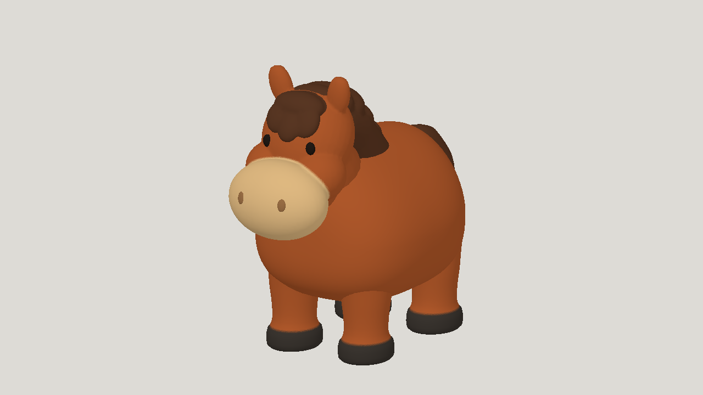

# Opus 5.5 high horse with a gallop video reference

| Measure | Value |
|---|---|
| Model | Opus 5.5 high |
| Driver | Claude Code subscription agent; rig by Codex subscription agent |
| Effort | high |
| Scope | One run, five static evaluations; the selected a04 rigged separately with five clips |
| Completed | true |
| Evaluations | 5 |
| Runtime seconds | unknown |
| Driver turns | unknown |
| Prompt tokens | unknown |
| Cached prompt tokens | unknown |
| Cache write tokens | unknown |
| Completion tokens | unknown |
| Reasoning tokens | unknown |
| Model calls | unknown |
| Cost USD (estimated) | 3.4682512 |
| Numeric score | 0.8242 |
| Gates passed | 0 |
| Gates total | 0 |

Token counts use the report's provider conventions. Reasoning is included in completion tokens; cache counters are not extra prompt tokens. Estimated cost is not an invoiced charge.

Five-evaluation study, not a production-ready asset. The builder saw gallop frames from a local video model and shaped separate legs for a rig. A separate Codex GPT-5.6 Sol high worker rigged it (four builds; all five clips pass). The run plays backwards: planted hooves slide toward the head. No gate checks direction. About 22 minutes modelling and 14 rigging.

Builder shown six-view gallop frames generated by a local video model (MiniMax H3) from the horse sheet, plus a paragraph asking for legs and tail a rig can swing.

Selected a04 scores 0.8242, the best of five. 22 minutes and US$3.47 for modelling (Claude Code notional estimate; subscription).

Rig by a separate Codex GPT-5.6 Sol high worker, four builds, 17 bones. All five clips pass the contract; run stretch 0.52%, worst edge 1.65x. Rig cost not reported.

The run gallop plays backwards: planted hooves move toward the head. No contract gate reads gait direction.

[Download selected model](model-01.glb)
