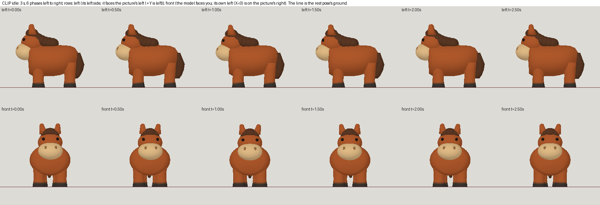
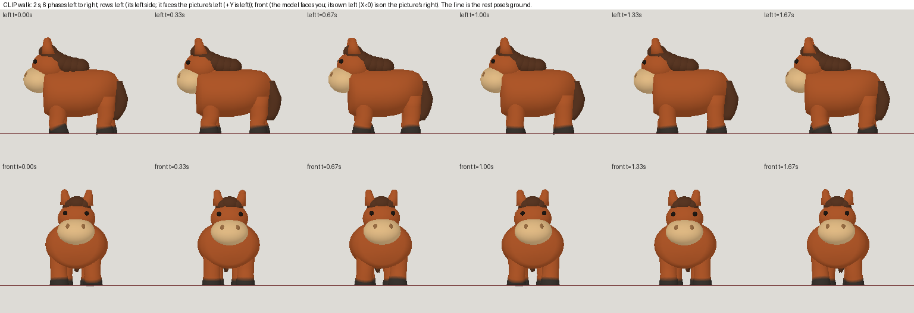
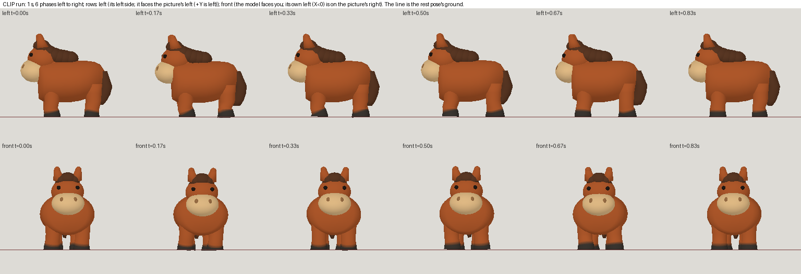
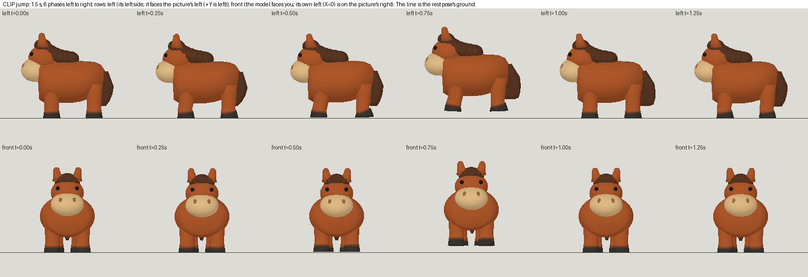
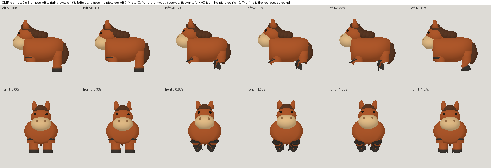

# Local Qwen3.8 high: horse with failed animations

| Measure | Value |
|---|---|
| Model | qwen3.8-27b-local |
| Driver | mesh-jig API agent through local llama-server |
| Effort | high |
| Scope | Five reviewed models; visual a05; nine failed rig submissions; 84-turn cap; last measured animation a08; IK not reached. |
| Completed | false |
| Evaluations | 5 |
| Runtime seconds | unknown |
| Driver turns | unknown |
| Prompt tokens | 4961956 |
| Cached prompt tokens | 4524087 |
| Cache write tokens | unknown |
| Completion tokens | 1288947 |
| Reasoning tokens | unknown |
| Model calls | 116 |
| Cost USD (reported) | 0 |
| Numeric score | 0.7463 |
| Gates passed | 0 |
| Gates total | 0 |

Token counts use the report's provider conventions. Reasoning is included in completion tokens; cache counters are not extra prompt tokens. Estimated cost is not an invoiced charge.

Failed rig: 0 passing candidates from 9 submissions; stopped at the 84-turn cap. Last measured animation a08 is shown unchanged. Idle/walk/run/jump/rear_up edge stretch 2.72x/3.60x/4.49x/12.97x/10.27x versus 2.5x. Run/walk sink 17.0/10.8 mm versus 8 mm. Rear-up stretched area is 4.70% versus 3%. IK was not reached.

First GLB: unchanged failed animation a08. Second GLB: selected static a05. Visual choice and numeric leader a05 scored 0.7463.

Local Qwen3.8-27B Q4_K_XL, requested high (template xhigh), 120000 reply-token ceiling. No hosted API charge; electricity/hardware costs not estimated.

All completed model, selection and rig calls included. No repair, altered gates or unmeasured post-budget draft.

[Download selected model](model-01.glb)

[Download selected model](model-02.glb)
