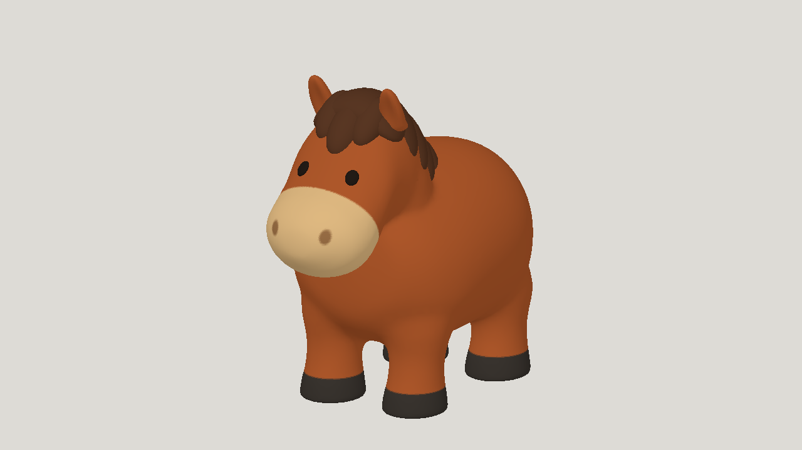
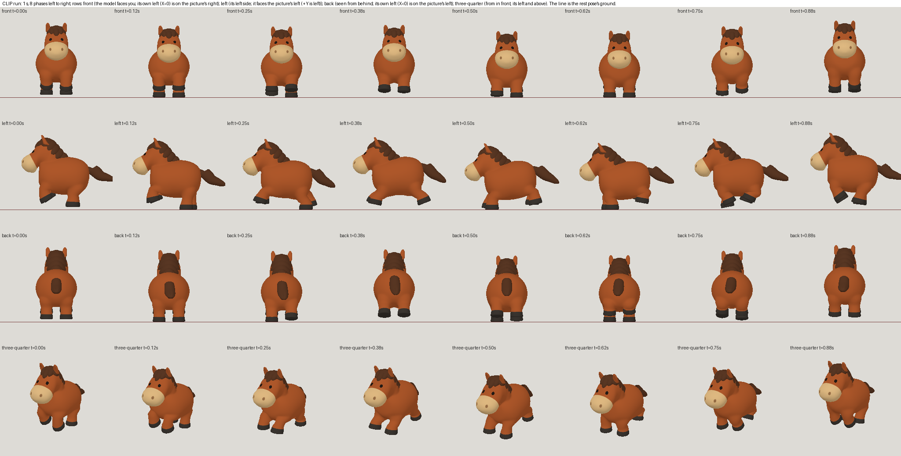
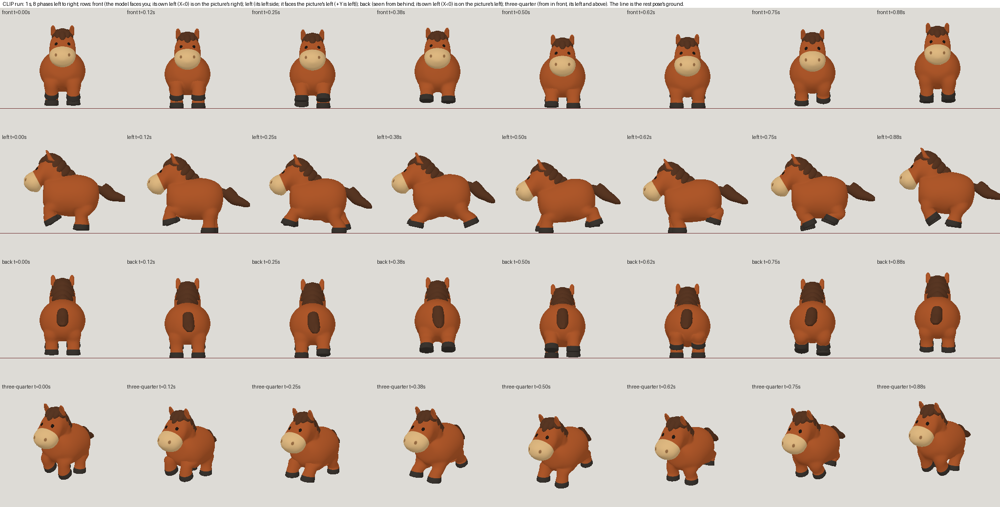
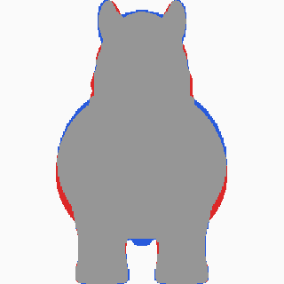

# GPT-6.2 Sol High horse

| Measure | Value |
|---|---|
| Model | gpt-6.2-sol |
| Driver | Codex subscription CLI |
| Effort | high |
| Scope | One independent High run. The fixed horse contract used a 25-build cap, patience of three and three consecutive unchanged ideation rounds. |
| Completed | true |
| Evaluations | 14 |
| Runtime seconds | 2680.169051 |
| Driver turns | 1 |
| Prompt tokens | 34575245 |
| Cached prompt tokens | 34278016 |
| Cache write tokens | unknown |
| Completion tokens | 79753 |
| Reasoning tokens | 32931 |
| Model calls | unknown |
| Cost USD (unavailable) | unknown |
| Numeric score | 0.8357 |
| Gates passed | 0 |
| Gates total | 0 |

Token counts use the report's provider conventions. Reasoning is included in completion tokens; cache counters are not extra prompt tokens. Estimated cost is not an invoiced charge.

Stopped at 14 of 25 scored builds after three unchanged ideation rounds. Three of 4 native rigs passed. The filleted shoulders and hips earned the visual pick. The gallop has a distinct suspended pose. Left-hind skate still reaches 0.268 m/s in Run.

The first rig overstretched four clips and let the tail cross the floor during Rear Up.

Image 01 is the selected model. Image 02 shows its Run clip. The remaining strips show Run in the rejected rig attempts, in submission order.

[Download selected model](model-01.glb)

[Download selected model](model-02.glb)

