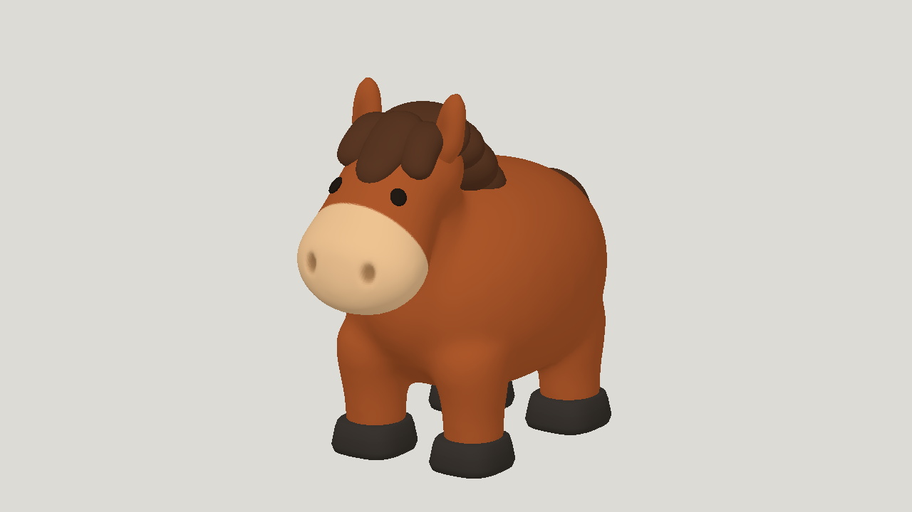

# GPT-6.2 Sol high: chunky cartoon horse

| Measure | Value |
|---|---|
| Model | GPT-6.2 Sol |
| Driver | Codex subscription |
| Effort | high |
| Scope | Five completed model evaluations from six submissions and three native rig passes from six submissions. |
| Completed | true |
| Evaluations | 5 |
| Runtime seconds | unknown |
| Driver turns | unknown |
| Prompt tokens | unknown |
| Cached prompt tokens | unknown |
| Cache write tokens | unknown |
| Completion tokens | unknown |
| Reasoning tokens | unknown |
| Model calls | unknown |
| Cost USD (unavailable) | unknown |
| Numeric score | 0.8054 |
| Gates passed | 0 |
| Gates total | 0 |

Token counts use the report's provider conventions. Reasoning is included in completion tokens; cache counters are not extra prompt tokens. Estimated cost is not an invoiced charge.

The visual selection shows the clearer eyes, rounded muzzle and distinct forelock. The latest and numeric leader each scored 0.8054 to four decimal places. The first static build exceeded 60,000 triangles and was retained privately as a failure.

The original paint and text-only motion contract was held throughout. The first rig exceeded the stretch limit. Two later rear-up trials put the tail below the floor. The selected rig passes all five native clips.

The short legs overlap from the side. The reference views differ in width and depth. Collision and engine-specific playback were outside the checks. Native model usage and subscription cost were unavailable.

The first model file contains the five native clips. The second is the selected static asset.

[Download selected model](model-01.glb)

[Download selected model](model-02.glb)
