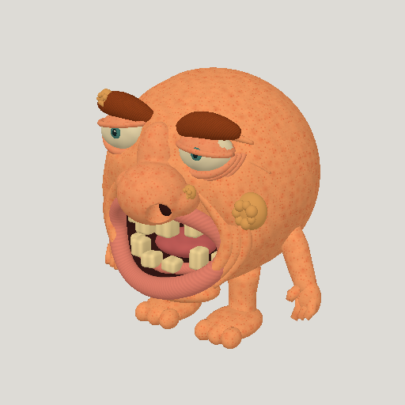
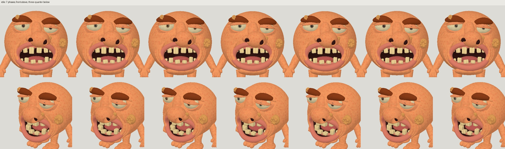
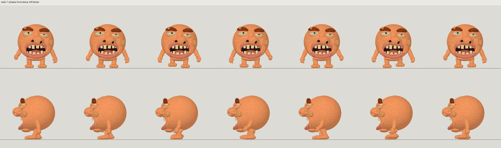
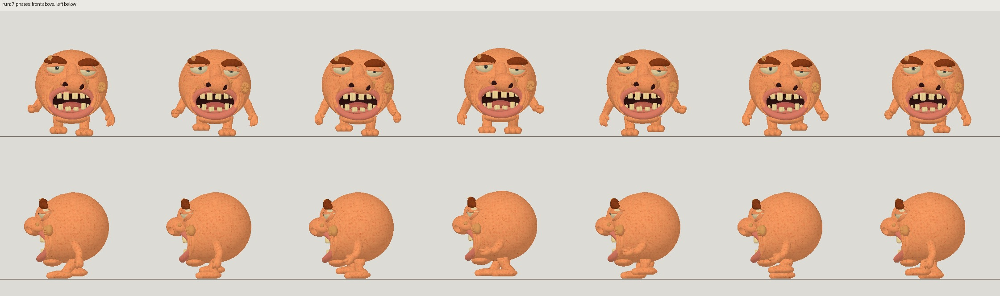
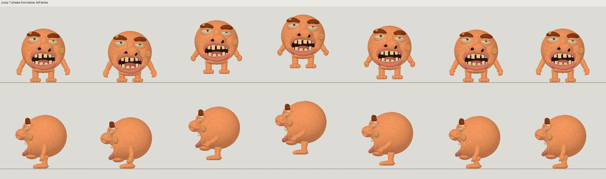
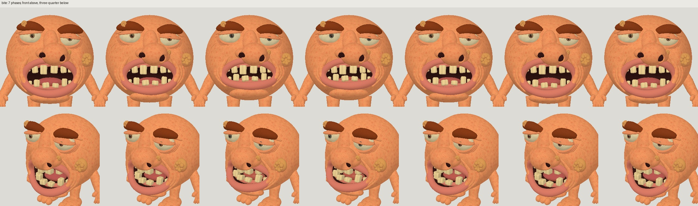
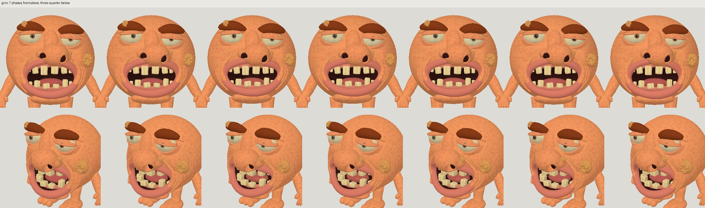
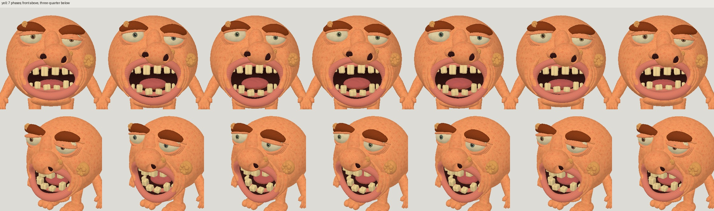
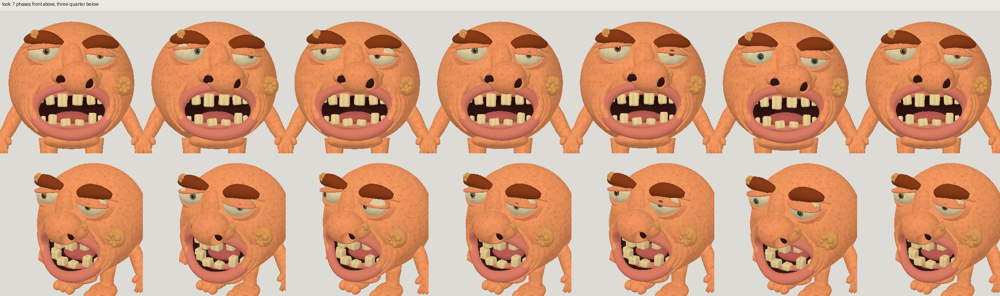

# Huge ugly head: Astra high animated

| Measure | Value |
|---|---|
| Model | gpt-6-astra |
| Driver | Native Codex delegated worker |
| Effort | high |
| Scope | Five evaluated modeling attempts, selected a05; three rig iterations, selected r03; idle, walk, run, jump, bite, grin, yell, look. |
| Completed | true |
| Evaluations | 5 |
| Runtime seconds | unknown |
| Driver turns | unknown |
| Prompt tokens | unknown |
| Cached prompt tokens | unknown |
| Cache write tokens | unknown |
| Completion tokens | unknown |
| Reasoning tokens | unknown |
| Model calls | unknown |
| Cost USD (unavailable) | unknown |
| Numeric score | 0.6943 |
| Gates passed | 3 |
| Gates total | 3 |

Token counts use the report's provider conventions. Reasoning is included in completion tokens; cache counters are not extra prompt tokens. Estimated cost is not an invoiced charge.

60,000-triangle ceiling; selected animated GLB contains 57,112 triangles.

Simplified sculpt; wrinkles, eyelid/chin integration and hands fall short of the reference. The grin is subtle.

One unified 24-bone body/face hierarchy. Idle, walk and run loop. Walk/run are in place; matching forward speeds are 0.166667 and 0.810185 m/s.

Runtime, token usage and cost are unavailable. Numeric gates and sampled contact checks are not a visual-quality or engine certification.

[Download selected model](model-01.glb)
