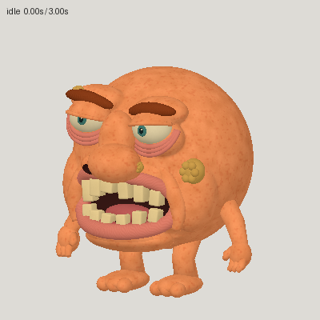
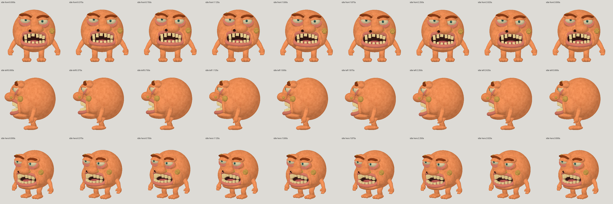
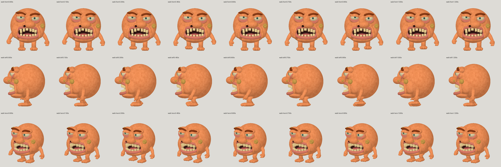
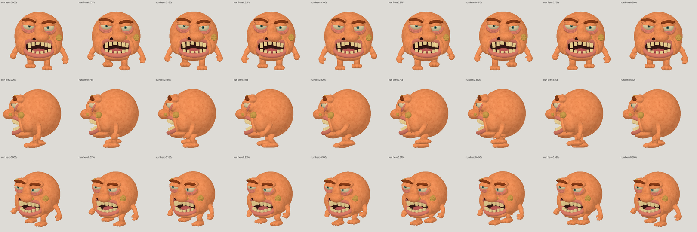
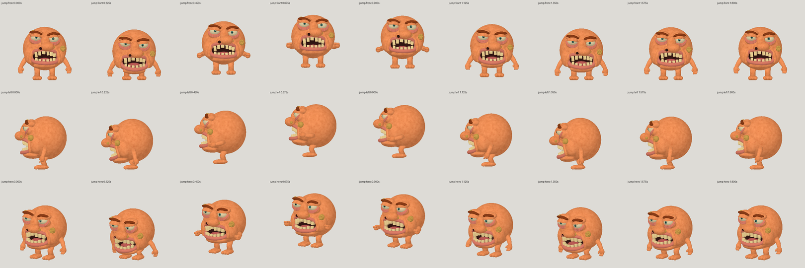
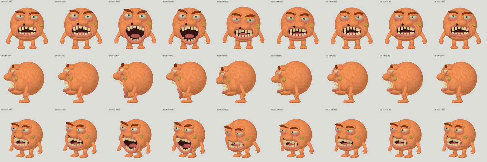
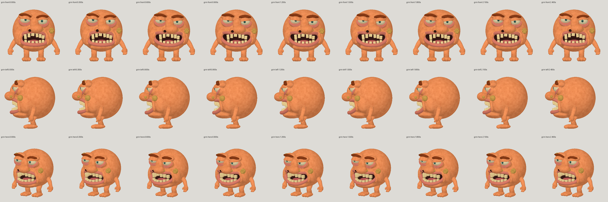
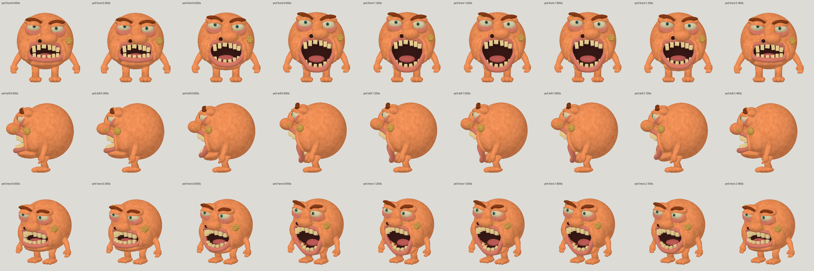
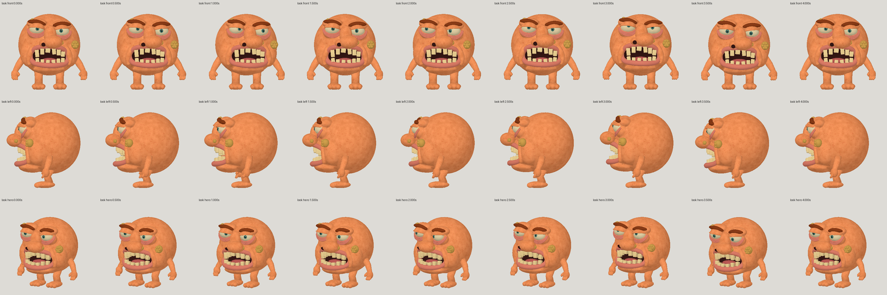

# Huge head: GPT-6 Astra high motion rebuild

| Measure | Value |
|---|---|
| Model | GPT-6 Astra |
| Driver | Codex native delegated worker |
| Effort | high |
| Scope | Fresh model, texture, rig and eight clips. Five evaluated modeling attempts plus one structural mouth-seam repair; visual/latest a06, numeric best a04; selected rig r04. |
| Completed | true |
| Evaluations | 6 |
| Runtime seconds | unknown |
| Driver turns | unknown |
| Prompt tokens | unknown |
| Cached prompt tokens | unknown |
| Cache write tokens | unknown |
| Completion tokens | unknown |
| Reasoning tokens | unknown |
| Model calls | unknown |
| Cost USD (unavailable) | unknown |
| Numeric score | 0.6846 |
| Gates passed | 3 |
| Gates total | 3 |

Token counts use the report's provider conventions. Reasoning is included in completion tokens; cache counters are not extra prompt tokens. Estimated cost is not an invoiced charge.

Eight native clips: idle, walk, run, jump, bite, grin, yell, look. Yell has a sustained wide opening; bite has one anticipation, forward lean and chomp.

Simplified sculpt and shallow side mouth enclosure. Bite does not fully seal; run flight is subtle, grin has limited cheek lift and closed lids look cap-like.

58,610 rendered triangles, painted 2048 texture, unified 23-bone hierarchy. Native checks and dense sampled checks pass; these do not certify visual quality or game-engine behavior.

Walk and run are in place. Match forward speed 0.0846354 m/s for walk and 0.4605263 m/s for run. Runtime, tokens and subscription cost were not reported.

[Download selected model](model-01.glb)
