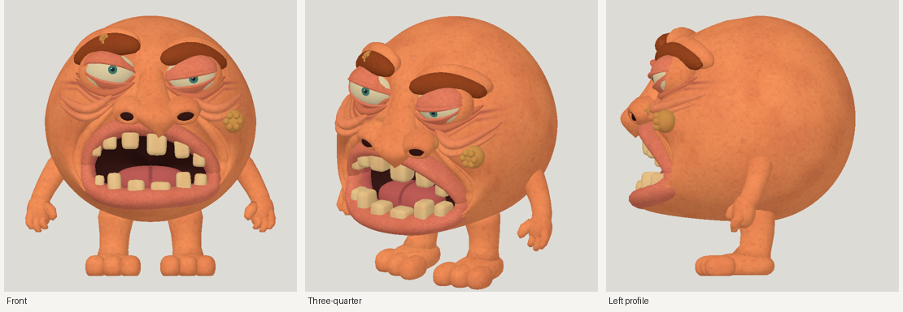
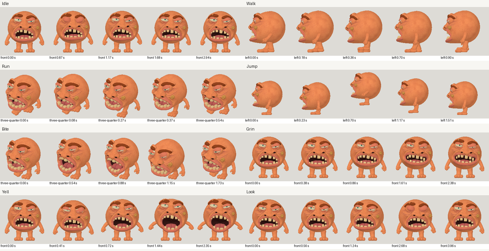

# Big ugly head with eight silent clips

| Measure | Value |
|---|---|
| Model | GPT-6.2 Astra |
| Driver | Codex desktop subscription |
| Effort | high |
| Scope | Fresh one-metre head study with five static evaluations and three passing rig candidates from 4 submissions. The selected static mesh supplies the embedded texture and all eight silent native clips. |
| Completed | true |
| Evaluations | 5 |
| Runtime seconds | 3071.0 |
| Driver turns | unknown |
| Prompt tokens | unknown |
| Cached prompt tokens | unknown |
| Cache write tokens | unknown |
| Completion tokens | unknown |
| Reasoning tokens | unknown |
| Model calls | unknown |
| Cost USD (unavailable) | unknown |
| Numeric score | 0.7044 |
| Gates passed | 3 |
| Gates total | 3 |

Token counts use the report's provider conventions. Reasoning is included in completion tokens; cache counters are not extra prompt tokens. Estimated cost is not an invoiced charge.

The fifth static candidate was the visual selection and numeric leader at 0.7044. It uses 57,256 triangles and one embedded 2048 by 2048 script-painted colour atlas. All five static candidates received a separate score-blind visual critique.

Model 01 is the animated export. Model 02 is its static source. The selected rig was submission 4. An earlier weighted eyelid test exceeded the deformation limits and was retained in the submission count.

The bite opens, lunges and holds one chomp. Its central teeth remain about 31 mm apart at their closest projected height. The yell holds open. The sampled blink covers both eyes, though its closed lids read as solid caps. The grin is restrained and the run briefly clears the ground.

The nose projects less in profile than the sheet. The mouth corners and eye hoods are flatter, the teeth more regular and the skin less deeply folded. These are native animation and static reference checks. No terrain or gameplay stage was part of this study.

Elapsed time covers frozen input setup through completion of the last native rig check. The Codex subscription exposes no per-run charge or token counts.

[Download selected model](model-01.glb)

[Download selected model](model-02.glb)
