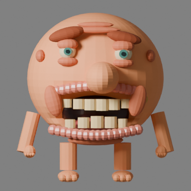
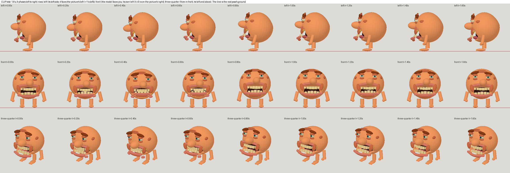

# Gemini 3.8 Flash High: Huge Ugly Head

| Measure | Value |
|---|---|
| Model | gemini-3.8-flash-high |
| Driver | Antigravity subscription CLI |
| Effort | high |
| Scope | Five modelling evaluations; 4 rig submissions, 3 passing. |
| Completed | true |
| Evaluations | 5 |
| Runtime seconds | unknown |
| Driver turns | unknown |
| Prompt tokens | unknown |
| Cached prompt tokens | unknown |
| Cache write tokens | unknown |
| Completion tokens | unknown |
| Reasoning tokens | unknown |
| Model calls | unknown |
| Cost USD (unavailable) | unknown |
| Numeric score | 0.607 |
| Gates passed | 3 |
| Gates total | 3 |

Token counts use the report's provider conventions. Reasoning is included in completion tokens; cache counters are not extra prompt tokens. Estimated cost is not an invoiced charge.

Five measured sculpt attempts under the 60,000 triangle cap. Visual pick a05 scored 0.6070. Numerical best 0.6070. Base colour uses vertex colour. The finish uses regional roughness.

3 of 4 rig submissions passed. The selected r04 carries eight 30 fps clips guided by the matched H3 references.

The low-poly head has faceted features and visible gaps at the limbs. The bite moves the jaw, while the segmented lips and exposed profile mouth remain visibly stylized.

[Download selected model](model-01.glb)

[Download selected model](model-02.glb)
