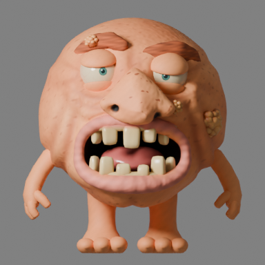
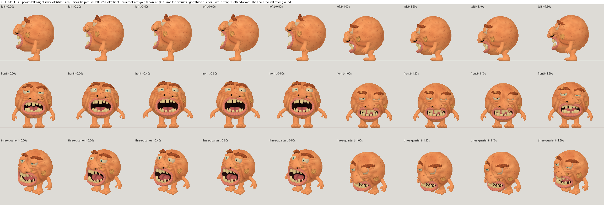

# Gemini 4 Neon High: Huge Ugly Head

| Measure | Value |
|---|---|
| Model | gemini-4-neon-high |
| Driver | Antigravity subscription CLI |
| Effort | high |
| Scope | Five modelling evaluations. 2 of 4 rig submissions passed. |
| Completed | false |
| Evaluations | 5 |
| Runtime seconds | unknown |
| Driver turns | unknown |
| Prompt tokens | unknown |
| Cached prompt tokens | unknown |
| Cache write tokens | unknown |
| Completion tokens | unknown |
| Reasoning tokens | unknown |
| Model calls | unknown |
| Cost USD (unavailable) | unknown |
| Numeric score | 0.6874 |
| Gates passed | 3 |
| Gates total | 3 |

Token counts use the report's provider conventions. Reasoning is included in completion tokens; cache counters are not extra prompt tokens. Estimated cost is not an invoiced charge.

Five measured sculpt attempts under the 60,000 triangle cap. Visual pick a05 scored 0.6874. Numerical best 0.6879. Base colour uses a script-painted texture. Finish adds normal map, roughness map.

2 of 4 rig submissions passed. Rig r04 carries eight 30 fps clips guided by the matched H3 references.

Antigravity quota paused the trial after two of four rigs passed, with three passes required by the run contract. This snapshot shows the latest passing rig, r04. The pale skin and simplified brow and lip folds soften the likeness. The heavy upper lids sit visibly proud of the eyes.

[Download selected model](model-01.glb)

[Download selected model](model-02.glb)
