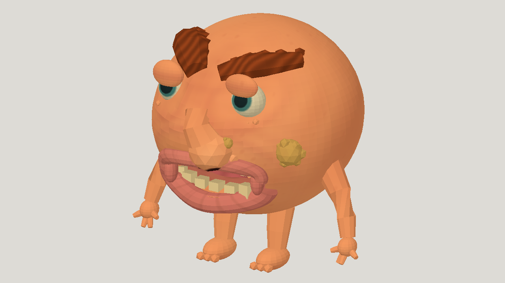

# Local Qwen3.8 high: static huge head; rigging timed out

| Measure | Value |
|---|---|
| Model | qwen3.8-27b-local |
| Driver | mesh-jig API agent through local llama-server |
| Effort | high |
| Scope | Five reviewed static evaluations; visual choice a02; first rig-writing request failed after three 30-minute stream timeouts. No rig submissions, animation or IK. |
| Completed | false |
| Evaluations | 5 |
| Runtime seconds | unknown |
| Driver turns | unknown |
| Prompt tokens | unknown |
| Cached prompt tokens | unknown |
| Cache write tokens | unknown |
| Completion tokens | unknown |
| Reasoning tokens | unknown |
| Model calls | 55 |
| Cost USD (reported) | 0 |
| Numeric score | 0.6091 |
| Gates passed | 3 |
| Gates total | 3 |

Token counts use the report's provider conventions. Reasoning is included in completion tokens; cache counters are not extra prompt tokens. Estimated cost is not an invoiced charge.

Static only: rigging produced no script, build or animation. The first rig-writing request timed out after three 30-minute attempts while still thinking (90 minutes total). Zero rig submissions; IK was not reached. Selected a02 retains a rear mouth membrane, weak surface detail and simplified hands/feet.

Selected static a02 scored 0.6091; numeric leader a05 scored 0.6353. No model repair or altered gates.

54 completed model/selection calls report 2088232 input, 1803378 cached input and 670887 completion tokens including thinking. Three timed-out rig streams have no final usage; all-stage token totals remain unknown.

Local Qwen3.8-27B Q4_K_XL; requested high maps to template xhigh; 120000 reply-token ceiling. Hosted API charge zero; electricity/hardware costs unestimated.

[Download selected model](model-01.glb)
