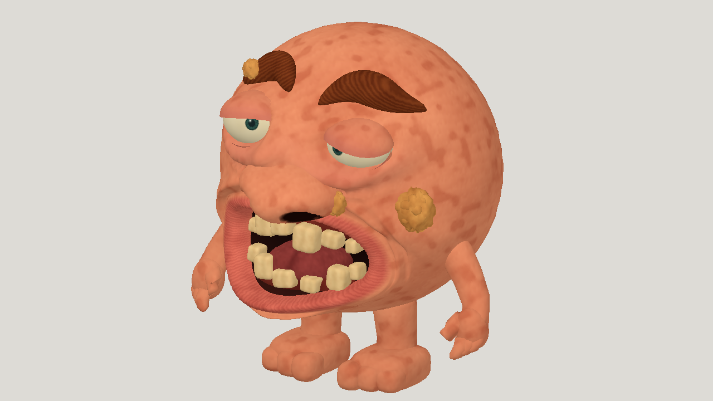
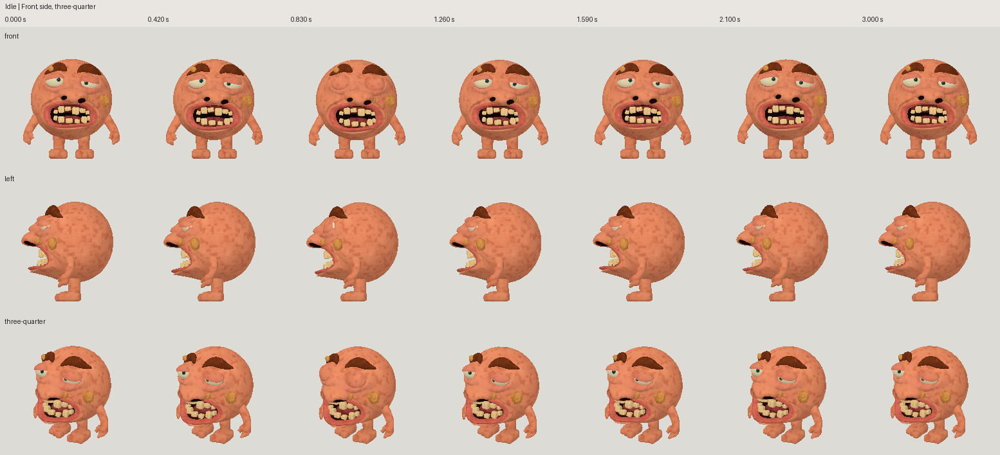
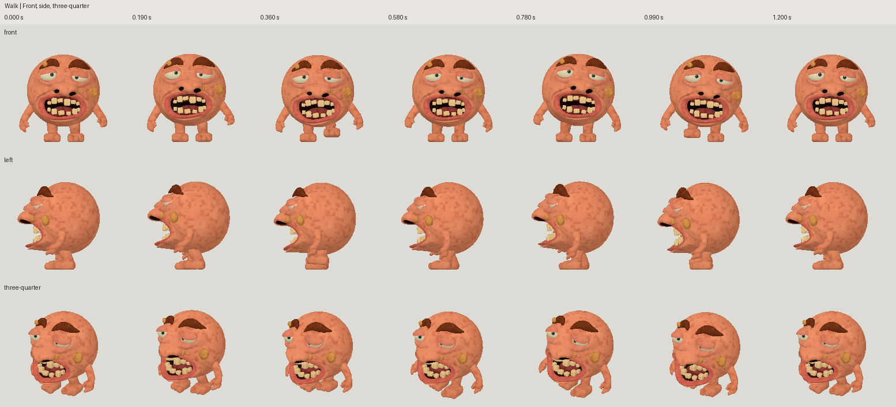
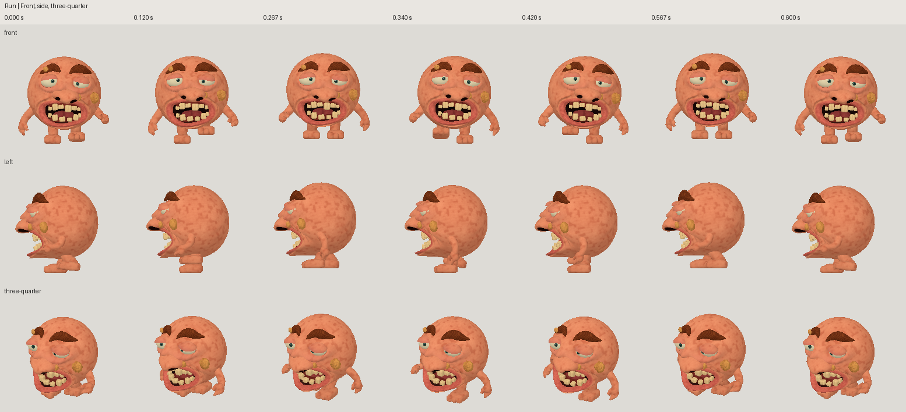
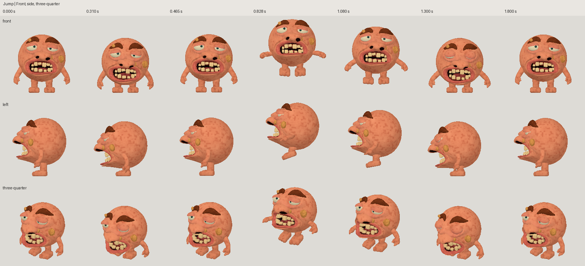
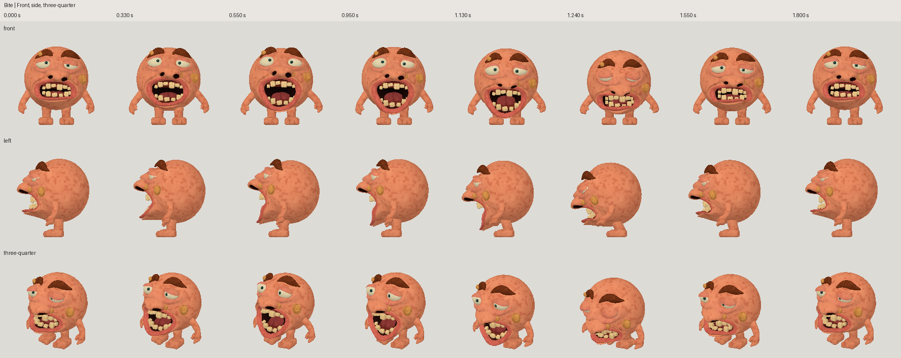
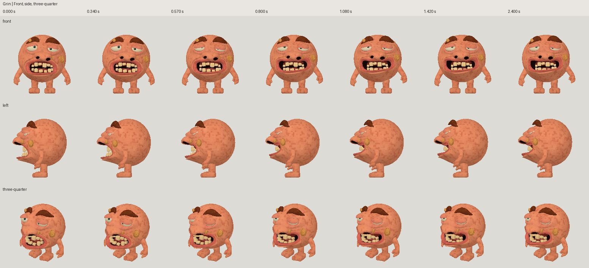
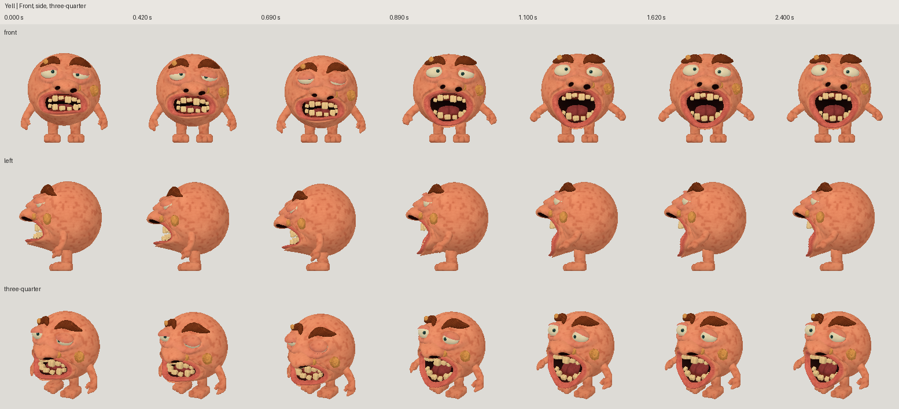
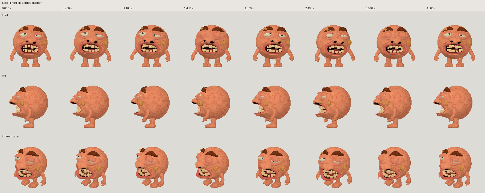

# Huge ugly head by GPT-6.2 Sol high

| Measure | Value |
|---|---|
| Model | GPT-6.2 Sol |
| Driver | Codex desktop, native subscription |
| Effort | high |
| Scope | Fresh single run with five completed static evaluations and one triangle-cap refusal. Three passing native rigs from four submissions. The same frozen sheet, painted texture limits and eight motion takes guided the run. |
| Completed | true |
| Evaluations | 5 |
| Runtime seconds | unknown |
| Driver turns | unknown |
| Prompt tokens | unknown |
| Cached prompt tokens | unknown |
| Cache write tokens | unknown |
| Completion tokens | unknown |
| Reasoning tokens | unknown |
| Model calls | unknown |
| Cost USD (unavailable) | unknown |
| Numeric score | 0.6909 |
| Gates passed | 3 |
| Gates total | 3 |

Token counts use the report's provider conventions. Reasoning is included in completion tokens; cache counters are not extra prompt tokens. Estimated cost is not an invoiced charge.

The selected, highest-scoring and latest sculpt was a05. It has 57,972 triangles, a script-painted 2048 px atlas and three passing static gates.

The first rig exceeded the run edge-stretch gate. The selected fourth submission delivers idle, walk, run, jump, bite, grin, yell and look with 29 bones. It holds the native rig contract and the same sampled limits between keys.

The chin retains a wedge-shaped profile and the folds are simplified. A crescent of sclera remains in profile during blink. Bite leaves uneven tooth gaps and grin has limited cheek lift. Walk and run play in place.

Model 01 is animated and Model 02 is static. Image 01 shows the static hero. Images 02 to 09 show timed poses from the exported rig. Both GLBs carry the same painted atlas.

The model run used a native Codex subscription. Evaluation ran locally. Model runtime, token usage and billed cost are unavailable. Visual motion review and sampled deformation checks accompany the static score.

[Download selected model](model-01.glb)

[Download selected model](model-02.glb)
