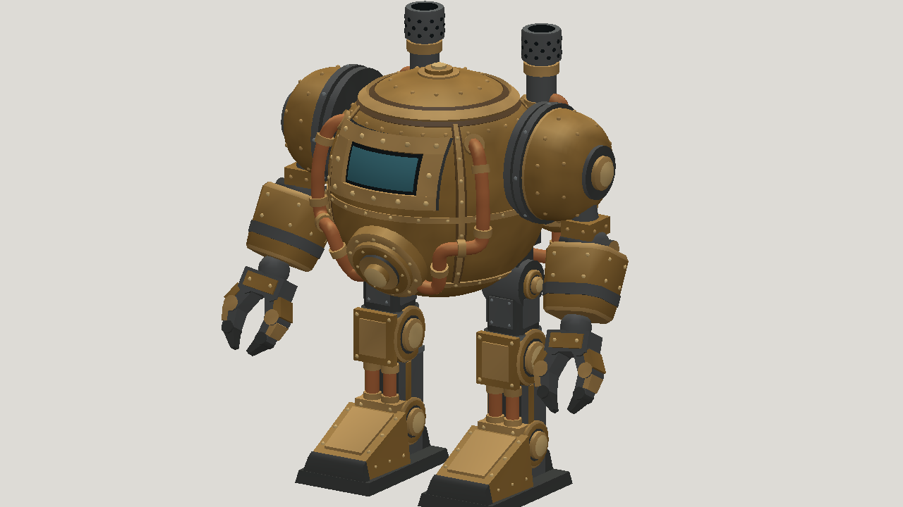

# Fable 5.2 high API: partial painted steampunk mech

| Measure | Value |
|---|---|
| Model | claude-fable-5-2 |
| Driver | mesh-jig via Anthropic API |
| Effort | high |
| Scope | Partial model and rig run: five static evaluations, four completed review iterations, one rig build |
| Completed | false |
| Evaluations | 5 |
| Runtime seconds | 4215.2 |
| Driver turns | unknown |
| Prompt tokens | 842419 |
| Cached prompt tokens | unknown |
| Cache write tokens | unknown |
| Completion tokens | 382643 |
| Reasoning tokens | unknown |
| Model calls | unknown |
| Cost USD (unavailable) | unknown |
| Numeric score | 0.6275 |
| Gates passed | 0 |
| Gates total | 0 |

Token counts use the report's provider conventions. Reasoning is included in completion tokens; cache counters are not extra prompt tokens. Estimated cost is not an invoiced charge.

Partial budget-stopped study: 5 static evaluations, 4 of 5 model/review iterations completed, and 1 of 3 rig builds. Selected a04, not the unreviewed fifth mesh. Idle, walk, run and jump are present; further rig refinement, joint contact and collisions are not certified.

The selected static score is 0.6275; resemblance is 0.4293. The rig has 31,480 triangles and 18 joints. The recorded rig checks report no issues; that is not production or engine-specific certification.

Runtime and token counters sum the two partial reports: modeling 3,290.3 seconds, rigging 924.9 seconds. Prompt and completion counters are provider-defined; completion includes reasoning.

Total API cost is unavailable. Known priced usage is estimated at US$16.637448 for modeling and US$5.407624 for rigging; three calls remain unpriced. These partial estimates are not settled charges.

The run stopped at its existing spending limits; publication did not resume generation or rigging.

Download order: model-01.glb is the four-clip animated rig; model-02.glb is the selected static mesh.

[Download selected model](model-01.glb)

[Download selected model](model-02.glb)
