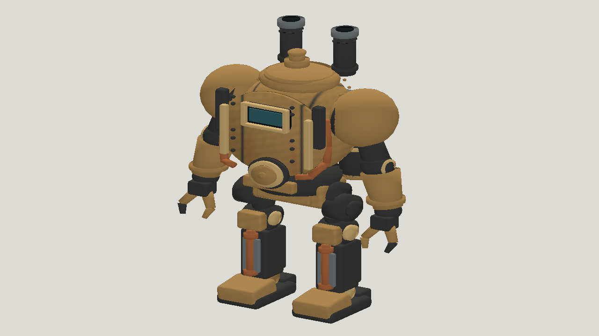

# GPT-6 Luna: mech

| Measure | Value |
|---|---|
| Model | GPT-6 Luna |
| Driver | Codex native subscription agent |
| Effort | high |
| Scope | Five static evaluations; selected model rigged with idle, walk, run and jump. |
| Completed | true |
| Evaluations | 5 |
| Runtime seconds | unknown |
| Driver turns | unknown |
| Prompt tokens | unknown |
| Cached prompt tokens | unknown |
| Cache write tokens | unknown |
| Completion tokens | unknown |
| Reasoning tokens | unknown |
| Model calls | unknown |
| Cost USD (unavailable) | unknown |
| Numeric score | 0.5645 |
| Gates passed | 0 |
| Gates total | 0 |

Token counts use the report's provider conventions. Reasoning is included in completion tokens; cache counters are not extra prompt tokens. Estimated cost is not an invoiced charge.

In-place shuffle with stance slip, restrained jump recovery and simplified mechanical detail. Collision and engine integration are not certified.

[Download selected model](model-01.glb)

[Download selected model](model-02.glb)
