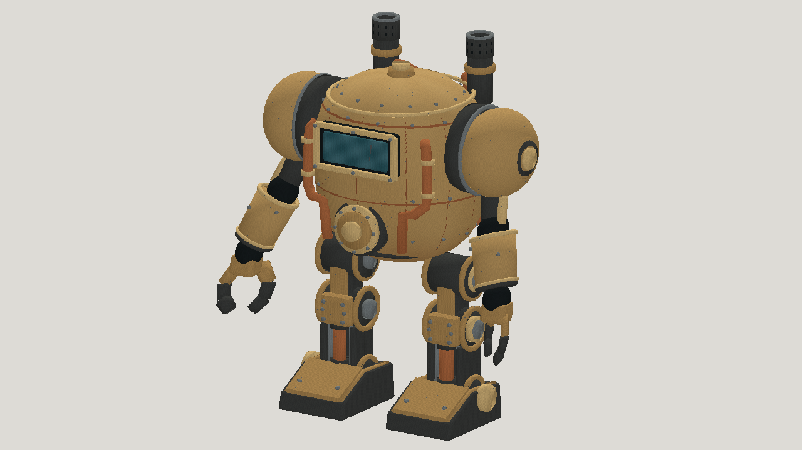

# GPT-6.1 Sol high: painted steampunk mech

| Measure | Value |
|---|---|
| Model | GPT-6.1 Sol |
| Driver | Codex subscription agent |
| Effort | high |
| Scope | Five successful static evaluations, selected textured mesh and four-clip rigid animation |
| Completed | true |
| Evaluations | 5 |
| Runtime seconds | unknown |
| Driver turns | unknown |
| Prompt tokens | unknown |
| Cached prompt tokens | unknown |
| Cache write tokens | unknown |
| Completion tokens | unknown |
| Reasoning tokens | unknown |
| Model calls | unknown |
| Cost USD (unavailable) | unknown |
| Numeric score | 0.5974 |
| Gates passed | 0 |
| Gates total | 0 |

Token counts use the report's provider conventions. Reasoning is included in completion tokens; cache counters are not extra prompt tokens. Estimated cost is not an invoiced charge.

Five-evaluation study; simplified mechanical forms and a single painted base-color atlas. In-place walk and run; joint contact and collisions are not certified. No engine-specific playback test. Dense sampling and rigid-component checks pass, but small transient intersections or linkage gaps remain uncertified.

Idle, walk, run and jump. Fourteen rigid bones. Subscription cost, normalized tokens and total runtime were not reported.

33,608 triangles. Visual selection: a05, score 0.5974; numeric best: a04, score 0.6008. Walk speed 0.4583 m/s; run speed 1.9737 m/s.

[Download selected model](model-01.glb)

[Download selected model](model-02.glb)
