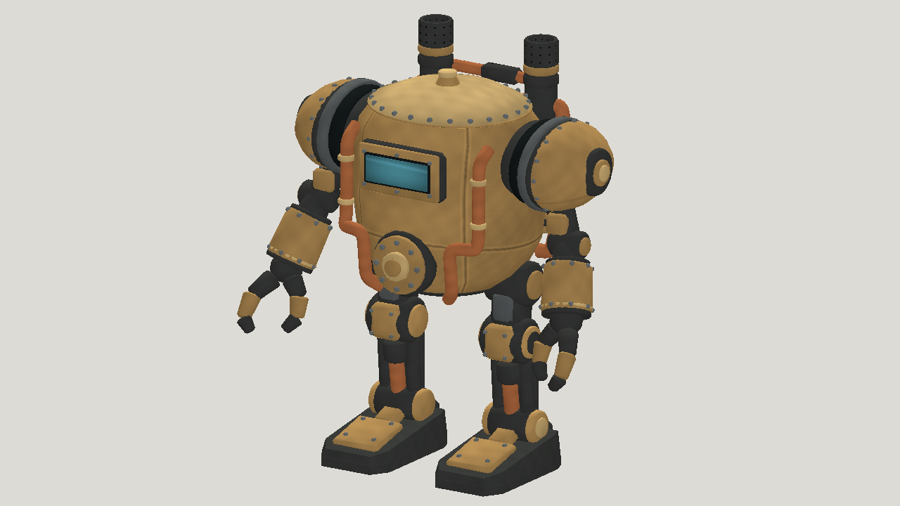

# GPT-6.2 Sol high: steampunk boiler mech

| Measure | Value |
|---|---|
| Model | GPT-6.2 Sol |
| Driver | Codex subscription |
| Effort | high |
| Scope | One fresh five-evaluation build and three passing native rig candidates. |
| Completed | true |
| Evaluations | 5 |
| Runtime seconds | unknown |
| Driver turns | unknown |
| Prompt tokens | unknown |
| Cached prompt tokens | unknown |
| Cache write tokens | unknown |
| Completion tokens | unknown |
| Reasoning tokens | unknown |
| Model calls | unknown |
| Cost USD (unavailable) | unknown |
| Numeric score | 0.6426 |
| Gates passed | 0 |
| Gates total | 0 |

Token counts use the report's provider conventions. Reasoning is included in completion tokens; cache counters are not extra prompt tokens. Estimated cost is not an invoiced charge.

The selected fifth model scored 0.6426, with silhouette overlap 0.848 and resemblance 0.4374. The third model led the numeric score at 0.6478. Each comparison used the original frozen sheet and 2048-pixel painted atlas contract.

Four native clips pass the rigid contract. Walk and run are in place. Simplified shell and foot shapes remain visible. Joint collision and engine playback were outside the checks.

Native model usage and subscription cost were unavailable. The first model file contains the four native clips. The second is the selected static asset.

[Download selected model](model-01.glb)

[Download selected model](model-02.glb)
