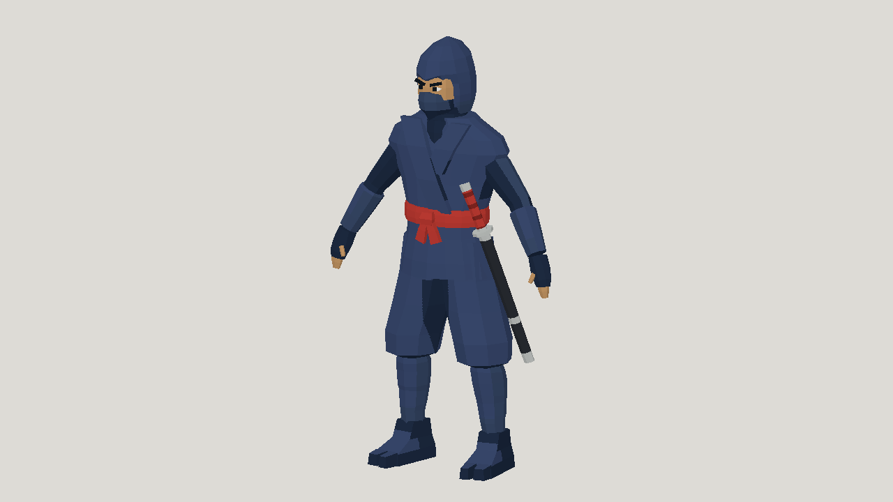

# Ninja: Gemini 4 Hydrogen High

| Measure | Value |
|---|---|
| Model | gemini-4-hydrogen-high |
| Driver | Antigravity subscription CLI |
| Effort | high |
| Scope | One independent run: five successful model evaluations and three passing rig candidates under the frozen reference contract. |
| Completed | true |
| Evaluations | 5 |
| Runtime seconds | unknown |
| Driver turns | unknown |
| Prompt tokens | unknown |
| Cached prompt tokens | unknown |
| Cache write tokens | unknown |
| Completion tokens | unknown |
| Reasoning tokens | unknown |
| Model calls | unknown |
| Cost USD (unavailable) | unknown |
| Numeric score | 0.6491 |
| Gates passed | 2 |
| Gates total | 3 |

Token counts use the report's provider conventions. Reasoning is included in completion tokens; cache counters are not extra prompt tokens. Estimated cost is not an invoiced charge.

Five successful model evaluations and three passing rig candidates under the unchanged contracts. The selected model still fails the colour-placement gate.

Simplified clothing folds, wraps and facial shaping. Walk and run are basic in-place gaits; the jump has a modest tuck. Attack reads as an unarmed punch or sweep; the sword remains sheathed.

Sampled motion checks do not certify all clothing intersections, planted-foot behavior or physical quality. Subscription cost is not reported.

[Download selected model](model-01.glb)
