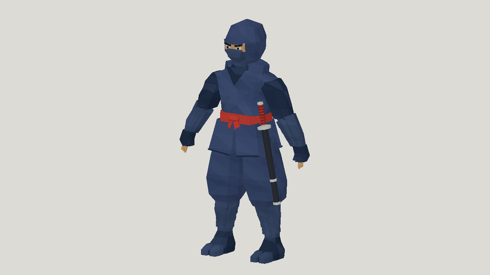

# GPT-6.1 Sol: ninja

| Measure | Value |
|---|---|
| Model | GPT-6.1 Sol |
| Driver | Codex native subscription agent |
| Effort | high |
| Scope | Five static evaluations; selected model rigged with idle, walk, run, jump and attack. |
| Completed | true |
| Evaluations | 5 |
| Runtime seconds | unknown |
| Driver turns | unknown |
| Prompt tokens | unknown |
| Cached prompt tokens | unknown |
| Cache write tokens | unknown |
| Completion tokens | unknown |
| Reasoning tokens | unknown |
| Model calls | unknown |
| Cost USD (unavailable) | unknown |
| Numeric score | 0.6443 |
| Gates passed | 3 |
| Gates total | 3 |

Token counts use the report's provider conventions. Reasoning is included in completion tokens; cache counters are not extra prompt tokens. Estimated cost is not an invoiced charge.

Simple low-poly form, blocky face and hands, heavy cuffs and inner-trouser contact beneath the skirt. Numeric motion checks do not certify collision-free animation.

[Download selected model](model-01.glb)

[Download selected model](model-02.glb)
