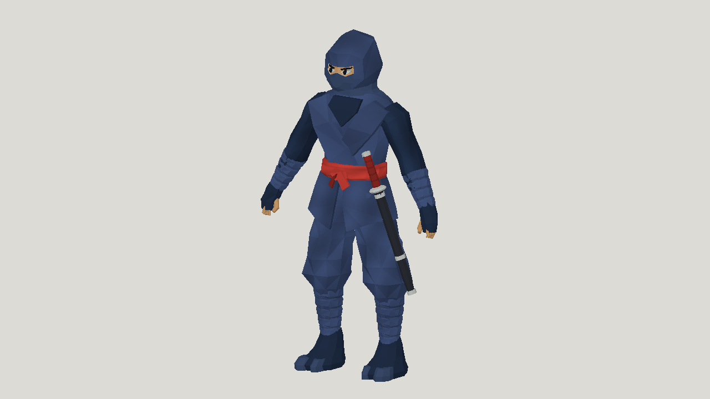

# Ninja, GPT-6.2 Sol high

| Measure | Value |
|---|---|
| Model | GPT-6.2 Sol |
| Driver | Codex native subscription |
| Effort | high |
| Scope | Five successful static evaluations and three passing native rigs on the same frozen ninja inputs as the earlier Sol high run. |
| Completed | true |
| Evaluations | 5 |
| Runtime seconds | unknown |
| Driver turns | unknown |
| Prompt tokens | unknown |
| Cached prompt tokens | unknown |
| Cache write tokens | unknown |
| Completion tokens | unknown |
| Reasoning tokens | unknown |
| Model calls | unknown |
| Cost USD (unavailable) | unknown |
| Numeric score | 0.6707 |
| Gates passed | 3 |
| Gates total | 3 |

Token counts use the report's provider conventions. Reasoning is included in completion tokens; cache counters are not extra prompt tokens. Estimated cost is not an invoiced charge.

Selected fifth model, 0.6707 and three of three static gates. The selected model has 4,224 triangles and one embedded 1024 × 1024 painted base-colour atlas.

Selected rig includes idle, walk, run, jump and an empty-hand attack with the sword sheathed. The gaits loop in place, and the skirt and sword can approach the thighs. Sampled deformation and ground clearance checks pass.

The eyes and fingertips are angular and small. The right-view mask has a back-facing sliver flagged by the static advisory.

Inference usage and subscription cost are unavailable. Static evaluations took 95.3 seconds in the evaluation tools, excluding model authoring and visual review.

[Download selected model](model-01.glb)
