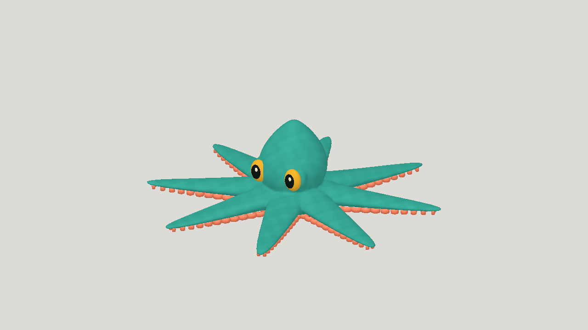
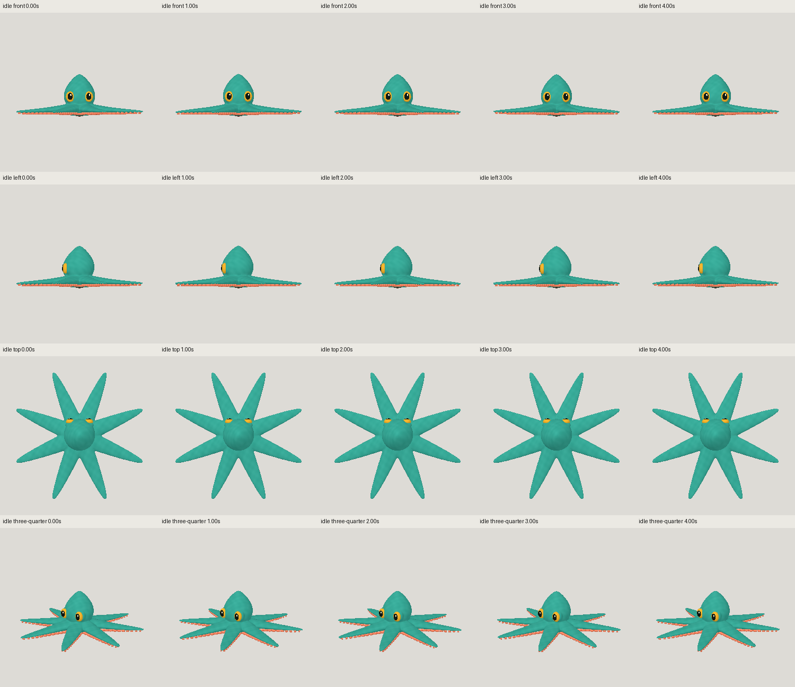
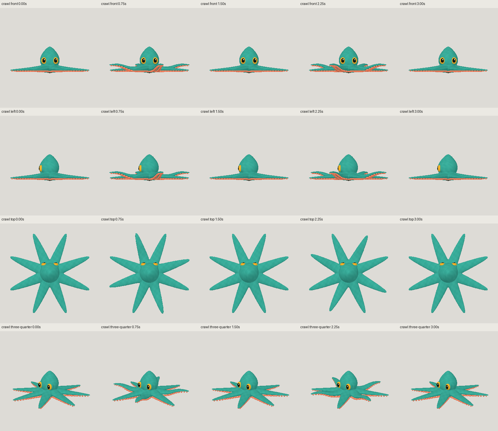
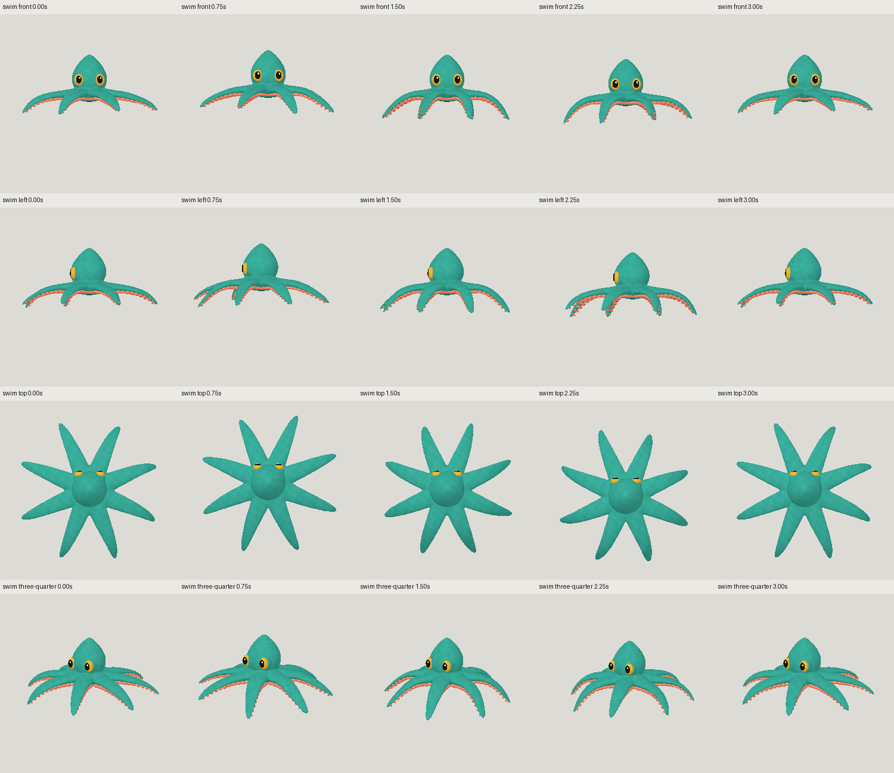
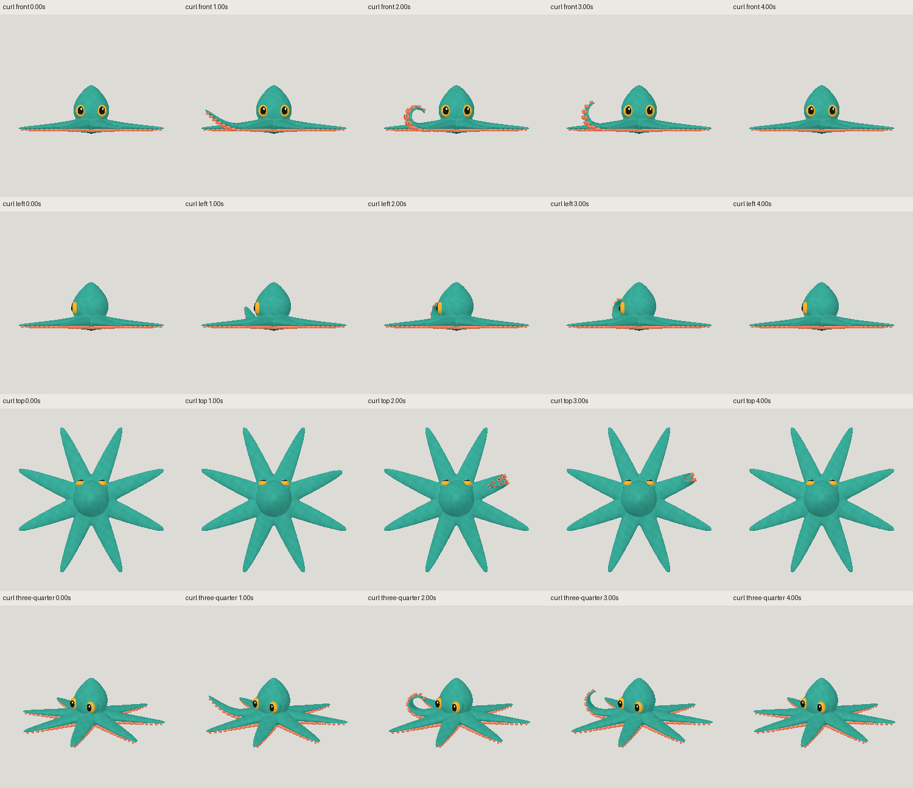
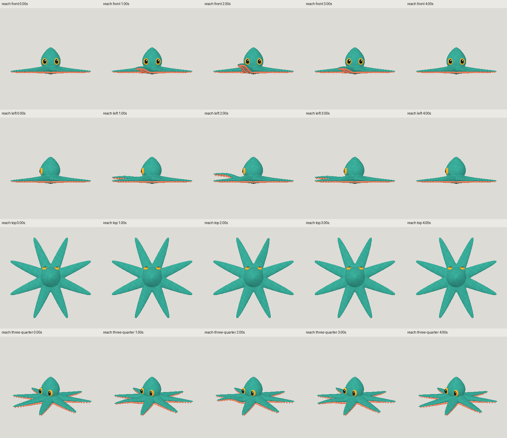
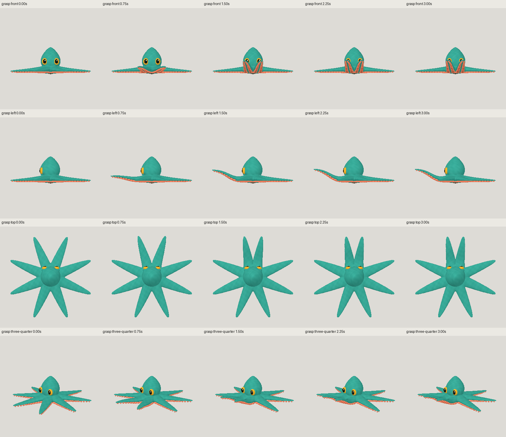
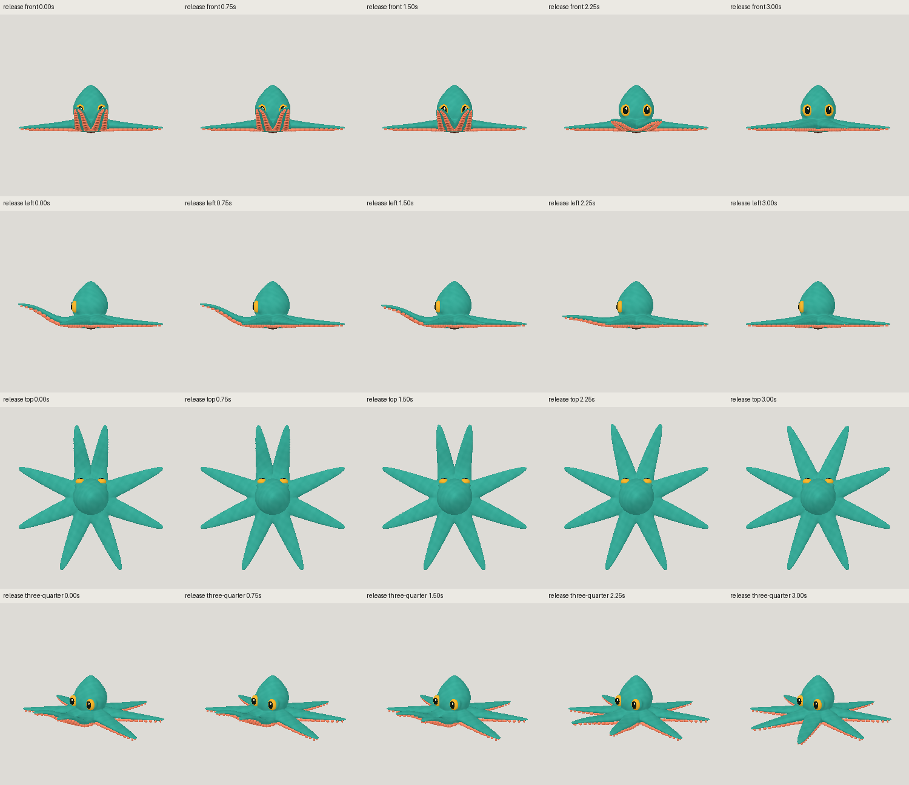
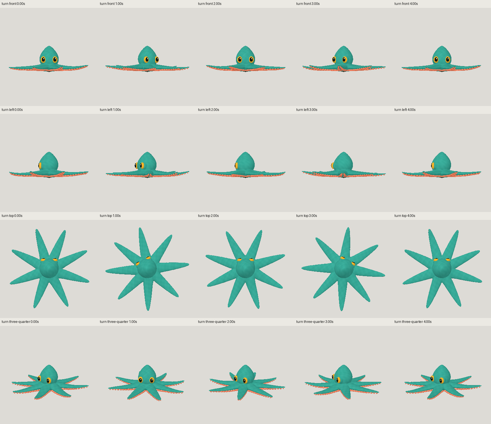

# Octopus: Astra high animated result

| Measure | Value |
|---|---|
| Model | GPT-6 Astra |
| Driver | Codex delegated worker |
| Effort | high |
| Scope | Five evaluated models; visual selection fourth; five rig refinements; eight clips |
| Completed | true |
| Evaluations | 5 |
| Runtime seconds | unknown |
| Driver turns | unknown |
| Prompt tokens | unknown |
| Cached prompt tokens | unknown |
| Cache write tokens | unknown |
| Completion tokens | unknown |
| Reasoning tokens | unknown |
| Model calls | unknown |
| Cost USD (unavailable) | unknown |
| Numeric score | 0.6965 |
| Gates passed | 1 |
| Gates total | 1 |

Token counts use the report's provider conventions. Reasoning is included in completion tokens; cache counters are not extra prompt tokens. Estimated cost is not an invoiced charge.

Selected by eye: fourth model, 44,644 active triangles, 82 joints. Latest fifth model is numeric best at 0.7008; it clips inner cup rims and was not selected.

Eight clips: idle, crawl, swim, curl, reach, grasp, release and turn. Crawl stays in place; swim uses traveling bend and axial twist. Grasp and release are paired actions, not seamless loops.

Reach target in model metres: (0.396, 1.025, 0.251). Empty grasp sphere: center (0, 1.044, 0.366), radius 0.20. No prop or physical contact claim.

Simplified arm volume, eyes and mantle. Frozen geometry and sampled motion checks pass; finite clearance proxies do not certify all mesh collisions. Runtime, token usage and cost unavailable.

[Download selected model](model-01.glb)
