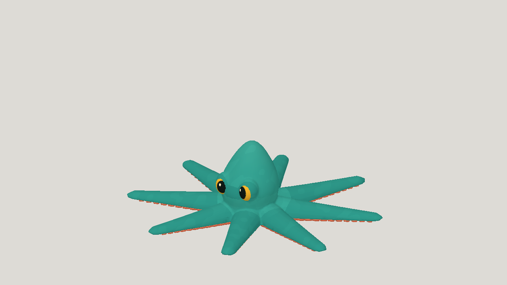

# Eight-arm octopus: Gemini 4 Hydrogen High

| Measure | Value |
|---|---|
| Model | gemini-4-hydrogen-high |
| Driver | Antigravity subscription CLI |
| Effort | high |
| Scope | One independent run: five successful model evaluations and three passing rig candidates under the frozen reference contract. |
| Completed | true |
| Evaluations | 5 |
| Runtime seconds | unknown |
| Driver turns | unknown |
| Prompt tokens | unknown |
| Cached prompt tokens | unknown |
| Cache write tokens | unknown |
| Completion tokens | unknown |
| Reasoning tokens | unknown |
| Model calls | unknown |
| Cost USD (unavailable) | unknown |
| Numeric score | 0.6663 |
| Gates passed | 1 |
| Gates total | 1 |

Token counts use the report's provider conventions. Reasoning is included in completion tokens; cache counters are not extra prompt tokens. Estimated cost is not an invoiced charge.

Five successful model evaluations; the earlier visual selection preserves visible eyes rather than using the numeric leader or latest model. Three rig candidates pass the unchanged eight-clip contract. Final animation preserves the original geometry, atlas and materials.

Faceted mantle, angular arms, shallow sucker details and restrained skin markings. Swim has a clear broad arm sweep, while crawl remains paddle-like and curl reads as a one-arm hook or wave. Reach is modest and returns to rest; grasp and release form a coherent closing/opening gesture, but have no object target and can crowd the eyes.

Independent multiview sampled review found no gross detachment or collapse. Sampled checks do not certify continuous contact, intersections, planted support, object holding or runtime behavior. Subscription cost is not reported.

[Download selected model](model-01.glb)
