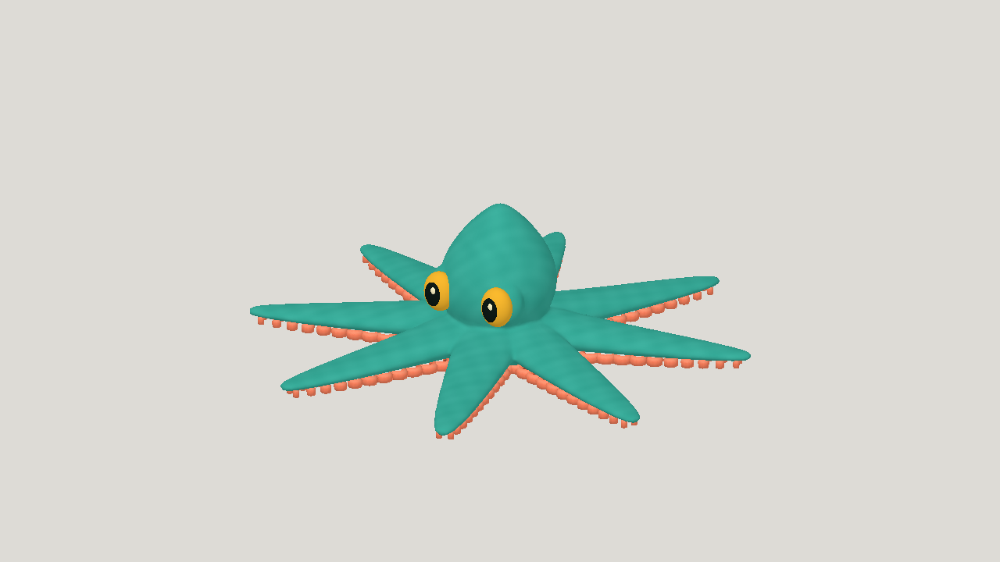

# GPT-6 Sol high octopus walk and leap

| Measure | Value |
|---|---|
| Model | GPT-6 Sol |
| Driver | Native Codex Sol high modeling and rigging |
| Effort | high |
| Scope | Five static evaluations seeded from the prior accepted octopus geometry; selected a05; two rig builds with crawl, walk, leap and turn |
| Completed | true |
| Evaluations | 5 |
| Runtime seconds | unknown |
| Driver turns | unknown |
| Prompt tokens | unknown |
| Cached prompt tokens | unknown |
| Cache write tokens | unknown |
| Completion tokens | unknown |
| Reasoning tokens | unknown |
| Model calls | unknown |
| Cost USD (unavailable) | unknown |
| Numeric score | 0.7015 |
| Gates passed | 1 |
| Gates total | 1 |

Token counts use the report's provider conventions. Reasoning is included in completion tokens; cache counters are not extra prompt tokens. Estimated cost is not an invoiced charge.

The short leap moves 0.28 m forward and rises 0.24 m; sampled deformation checks do not certify all mesh collisions.

[Download selected model](model-01.glb)
