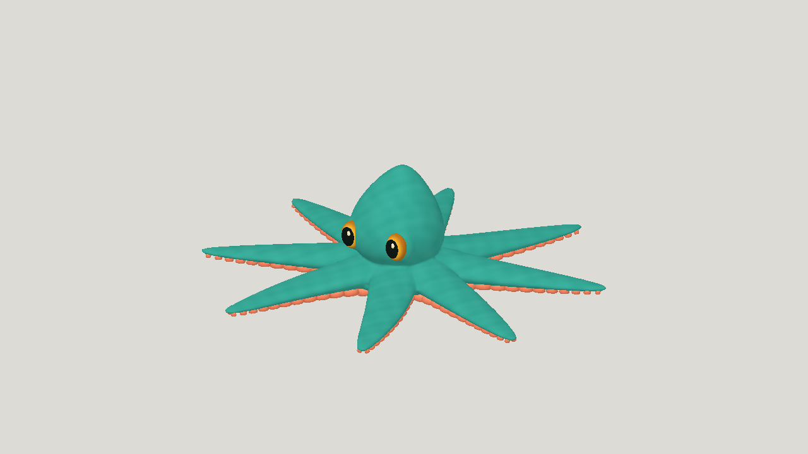

# Octopus, GPT-6.2 Sol high

| Measure | Value |
|---|---|
| Model | GPT-6.2 Sol |
| Driver | Codex native subscription |
| Effort | high |
| Scope | Five successful model evaluations from the same accepted baseline as the earlier Sol study and one native four-clip rig submission |
| Completed | true |
| Evaluations | 5 |
| Runtime seconds | unknown |
| Driver turns | unknown |
| Prompt tokens | unknown |
| Cached prompt tokens | unknown |
| Cache write tokens | unknown |
| Completion tokens | unknown |
| Reasoning tokens | unknown |
| Model calls | unknown |
| Cost USD (unavailable) | unknown |
| Numeric score | 0.707 |
| Gates passed | 1 |
| Gates total | 1 |

Token counts use the report's provider conventions. Reasoning is included in completion tokens; cache counters are not extra prompt tokens. Estimated cost is not an invoiced charge.

The selected model scored 0.7070 against 0.7015 for the earlier Sol study. The identical starting script evaluated at 0.6964 in this run and 0.6965 in the recorded study.

The arms stay mostly straight at rest, and the hero view falls short of the fuller arm curl in the illustration. The exported native clips are crawl, walk, leap and turn. Deformation and floor checks sample the animation.

The evaluator recorded 345.3 seconds across five model evaluations. Total runtime, inference usage and cost are unavailable.

[Download selected model](model-01.glb)
