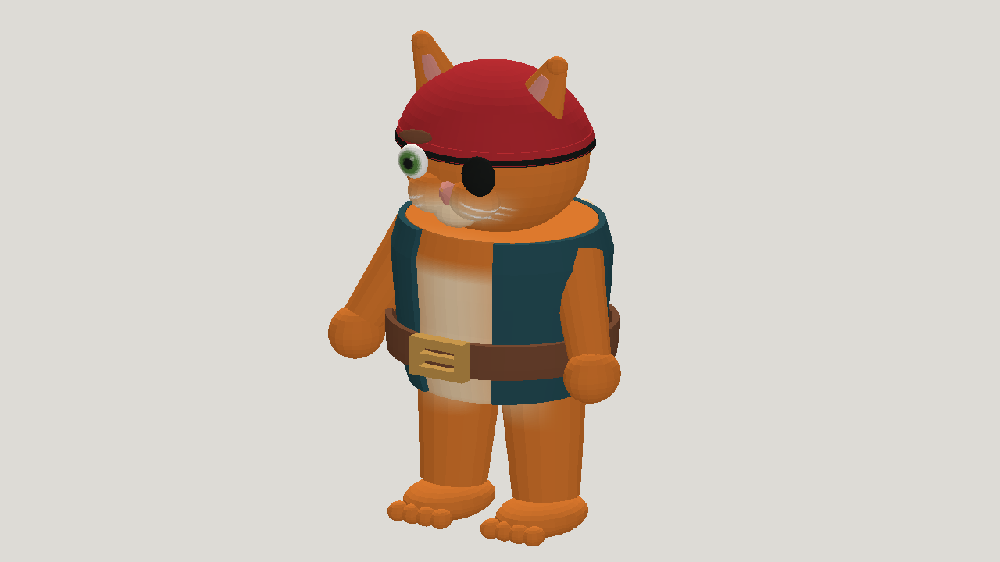
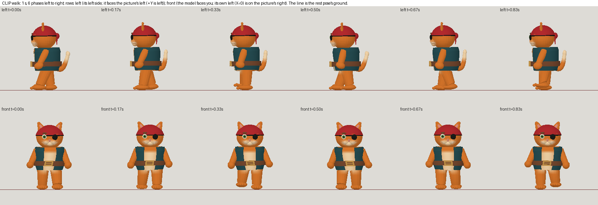
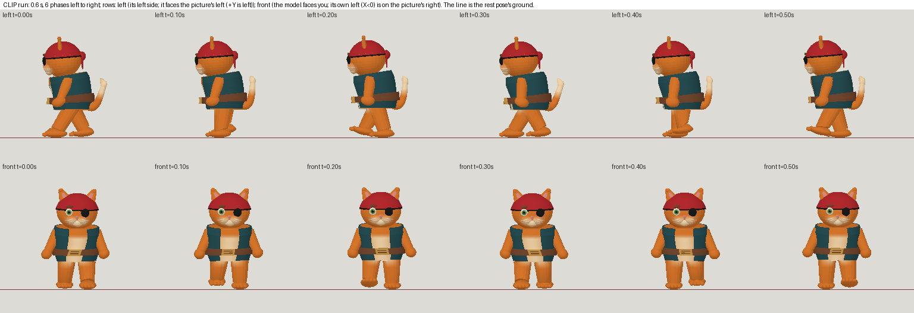

# Inkling 2 Mini High: pirate cat

| Measure | Value |
|---|---|
| Model | thinkingmachines/inkling-2-mini |
| Driver | Mesh Jig API agent via OpenRouter |
| Effort | high |
| Scope | One OpenRouter run via Prime Intellect. Five static meshes; no rig passed. |
| Completed | false |
| Evaluations | 5 |
| Runtime seconds | 9466.7 |
| Driver turns | unknown |
| Prompt tokens | 5297805 |
| Cached prompt tokens | 3694720 |
| Cache write tokens | unknown |
| Completion tokens | 1495531 |
| Reasoning tokens | 1275460 |
| Model calls | unknown |
| Cost USD (reported) | 0.6243114750000001 |
| Numeric score | 0.5263 |
| Gates passed | 14 |
| Gates total | 19 |

Token counts use the report's provider conventions. Reasoning is included in completion tokens; cache counters are not extra prompt tokens. Estimated cost is not an invoiced charge.

Experimental animation only: 0 of 12 rigs passed. This candidate exceeded the 3x edge-stretch limit in walk (3.54x) and run (4.82x). Selected static mesh passed 14/19 checks; no game-ready scene was produced.

The first GLB contains four native diagnostic clips. The second is the frozen static mesh.

One failed request did not return a usage receipt; the reported cost is a lower bound.

[Download selected model](model-01.glb)

[Download selected model](model-02.glb)
