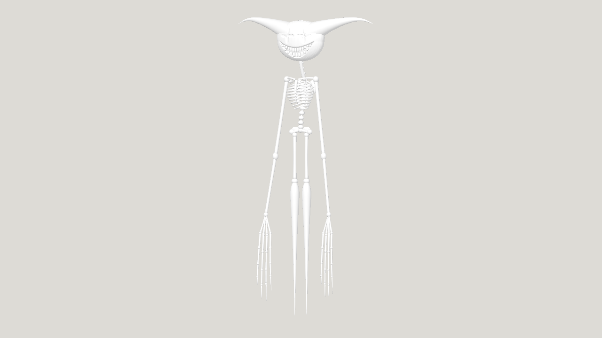

# Opus 5.5 high: Skeletal Steve with walk, idle and sprint

| Measure | Value |
|---|---|
| Model | claude-opus-5-5 |
| Driver | Mesh Jig API agent (visual modelling and rig workflows) via the Anthropic API |
| Effort | high |
| Scope | One five-build static run and two rig runs on the chosen mesh. Cost sums the model run and both rig runs at list price; the score refers to the static visual pick a05. |
| Completed | true |
| Evaluations | 5 |
| Runtime seconds | 3885.6 |
| Driver turns | unknown |
| Prompt tokens | 3530921 |
| Cached prompt tokens | unknown |
| Cache write tokens | unknown |
| Completion tokens | 267808 |
| Reasoning tokens | unknown |
| Model calls | unknown |
| Cost USD (estimated) | 19.479844 |
| Numeric score | 0.3716 |
| Gates passed | 0 |
| Gates total | 0 |

Token counts use the report's provider conventions. Reasoning is included in completion tokens; cache counters are not extra prompt tokens. Estimated cost is not an invoiced charge.

Approximate, written from a text brief. The hand plant lands ahead of the shoulder at a slant and reads as a long-armed lean, not a flat palm. Planted spikes move back unevenly through the catch pause, so a game moving the root would see slight slide. Small stray weights remain at finger joints and the chest. The static build has no acceptance gates and resemblance 0.4179. Sampled checks do not certify continuous collision clearance or game-engine readiness.

Approximate, written from a text brief. A bound, not a diagonal gait: left and right move almost together. The shoulders sit barely below the hips, spike tips slide a little at touchdown and lift-off, and 0.29% of the surface folds on the inside of bends at 0.5 s. Small stray hand weights remain. The static build has no acceptance gates and resemblance 0.4179. Sampled checks do not certify game-engine readiness.

Walk and idle: 7 rig submissions, 4 in contract, a07 delivered. Sprint: 9 submissions, 4 in contract, a09 delivered.

The numeric checks do not establish polished or game-ready motion. No terrain rig was produced.

[Download selected model](model-01.glb)

[Download selected model](model-02.glb)
