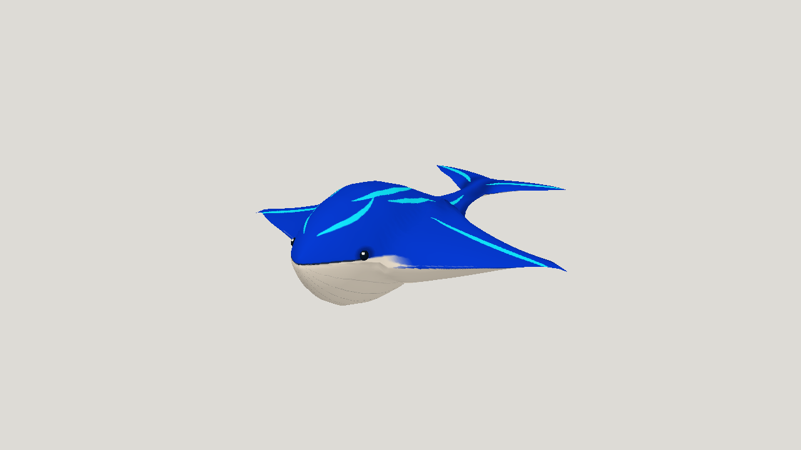

# Sky-whale manta: Gemini 4 Hydrogen High

| Measure | Value |
|---|---|
| Model | gemini-4-hydrogen-high |
| Driver | Antigravity subscription CLI |
| Effort | high |
| Scope | One independent run: five successful model evaluations and three passing rig candidates under the frozen reference contract. |
| Completed | true |
| Evaluations | 5 |
| Runtime seconds | unknown |
| Driver turns | unknown |
| Prompt tokens | unknown |
| Cached prompt tokens | unknown |
| Cache write tokens | unknown |
| Completion tokens | unknown |
| Reasoning tokens | unknown |
| Model calls | unknown |
| Cost USD (unavailable) | unknown |
| Numeric score | 0.6431 |
| Gates passed | 1 |
| Gates total | 1 |

Token counts use the report's provider conventions. Reasoning is included in completion tokens; cache counters are not extra prompt tokens. Estimated cost is not an invoiced charge.

Five successful model evaluations; the visual selection differs from the numeric leader. Three rig candidates pass the unchanged contract.

Angular fins and fluke, simplified facial details and cyan markings. Hover, flap and turn remain legible; fin bending is somewhat stiff and tail follow-through restrained.

Motion reviewed from sampled multiview poses. Contract checks do not certify all collisions or physical behavior. Subscription cost is not reported.

[Download selected model](model-01.glb)
