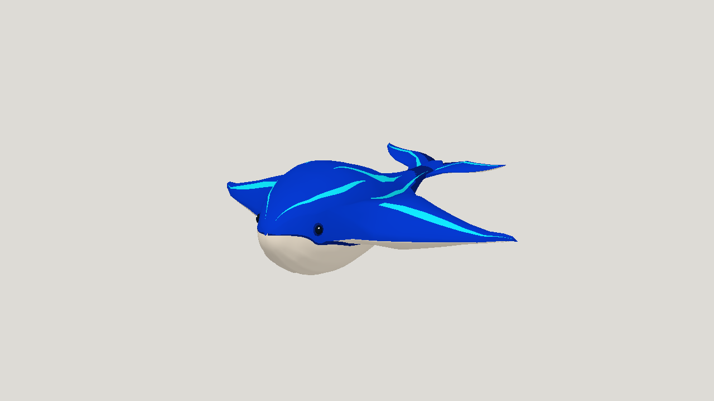

# Sky Whale, GPT-6.2 Sol high

| Measure | Value |
|---|---|
| Model | GPT-6.2 Sol |
| Driver | Codex native subscription |
| Effort | high |
| Scope | Five successful static evaluations and three passing native rig candidates on the same frozen reference and clip inputs as the earlier Sol high run. |
| Completed | true |
| Evaluations | 5 |
| Runtime seconds | unknown |
| Driver turns | unknown |
| Prompt tokens | unknown |
| Cached prompt tokens | unknown |
| Cache write tokens | unknown |
| Completion tokens | unknown |
| Reasoning tokens | unknown |
| Model calls | unknown |
| Cost USD (unavailable) | unknown |
| Numeric score | 0.6397 |
| Gates passed | 1 |
| Gates total | 1 |

Token counts use the report's provider conventions. Reasoning is included in completion tokens; cache counters are not extra prompt tokens. Estimated cost is not an invoiced charge.

The fifth model is the visual selection. It and the third model both scored 0.6397 at reported precision. Its 13,408 vertex-colored triangles include the connected fin roots, notched fluke and tapered markings. The 0.580 resemblance exceeds the 0.500 gate.

Selected rig includes hover_glide, fin_flap and gentle_turn. The bank leads the heading change and the tail follows through. The loops stay in place. The simplified muzzle, thicker fins and relatively flat fluke remain visible.

Inference usage and subscription cost are unavailable. Static evaluations took 115.4 seconds in the evaluation tools, excluding authoring and visual review.

[Download selected model](model-01.glb)
