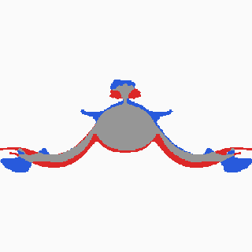

# GPT-6.2 Astra High, Codex · Fly loop correction

| Measure | Value |
|---|---|
| Model | GPT-6.2 Astra High, Codex |
| Driver | Codex subscription |
| Effort | high |
| Scope | Manual Fly loop repair on the original benchmark export. |
| Completed | true |
| Evaluations | 6 |
| Runtime seconds | 2550.0 |
| Driver turns | unknown |
| Prompt tokens | unknown |
| Cached prompt tokens | unknown |
| Cache write tokens | unknown |
| Completion tokens | unknown |
| Reasoning tokens | unknown |
| Model calls | unknown |
| Cost USD (unavailable) | unknown |
| Numeric score | 0.5726 |
| Gates passed | 0 |
| Gates total | 0 |

Token counts use the report's provider conventions. Reasoning is included in completion tokens; cache counters are not extra prompt tokens. Estimated cost is not an invoiced charge.

The feed lining stayed attached in all 73 checked poses and the back wall reached 162 mm behind the jaw hinge at full gape. The neutral wing outline differs from the painted sheet.

The Fly seam was manually smoothed after the run.

The frozen modelling scores still describe the original run.

[Download selected model](model-01.glb)

