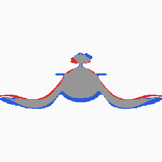

# Fable 5.2 high, Claude Code · Swallowtail Orchard

| Measure | Value |
|---|---|
| Model | Fable 5.2 high, Claude Code |
| Driver | Claude Code subscription (claude -p) |
| Effort | high |
| Scope | One model, rig and animations, with a 60,000-triangle cap and at most ten evaluated models. |
| Completed | true |
| Evaluations | 5 |
| Runtime seconds | 4260.0 |
| Driver turns | unknown |
| Prompt tokens | unknown |
| Cached prompt tokens | unknown |
| Cache write tokens | unknown |
| Completion tokens | unknown |
| Reasoning tokens | unknown |
| Model calls | unknown |
| Cost USD (unavailable) | unknown |
| Numeric score | 0.7166 |
| Gates passed | 0 |
| Gates total | 0 |

Token counts use the report's provider conventions. Reasoning is included in completion tokens; cache counters are not extra prompt tokens. Estimated cost is not an invoiced charge.

From an exact side view the open mouth shows through to the far wing, and the wings follow the front, rear and top paintings rather than the side painting. Feed lining depth was 97% of rest at full gape and stayed attached in sampled poses. Eye aim stops 13 degrees short of the lens.

[Download selected model](model-01.glb)

