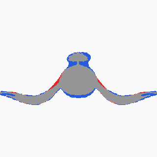

# Haiku 5.5 high, Claude Code · Swallowtail Orchard

| Measure | Value |
|---|---|
| Model | Haiku 5.5 high, Claude Code |
| Driver | Claude Code subscription (claude -p) |
| Effort | high |
| Scope | One model, rig and animations, with a 60,000-triangle cap and at most ten evaluated models. |
| Completed | false |
| Evaluations | 6 |
| Runtime seconds | 1452.0 |
| Driver turns | unknown |
| Prompt tokens | unknown |
| Cached prompt tokens | unknown |
| Cache write tokens | unknown |
| Completion tokens | unknown |
| Reasoning tokens | unknown |
| Model calls | unknown |
| Cost USD (unavailable) | unknown |
| Numeric score | 0.5432 |
| Gates passed | 0 |
| Gates total | 0 |

Token counts use the report's provider conventions. Reasoning is included in completion tokens; cache counters are not extra prompt tokens. Estimated cost is not an invoiced charge.

Experimental diagnostic. The model has no mouth, so there is no feed clip and the smile-and-wink clip has no smile. A later mouth attempt had a belly winding defect and was not selected. Four clips are delivered.

[Download selected model](model-01.glb)

