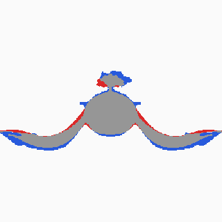

# Gemini 4 Hydrogen High, Antigravity · Swallowtail Orchard

| Measure | Value |
|---|---|
| Model | Gemini 4 Hydrogen High, Antigravity |
| Driver | Antigravity subscription CLI |
| Effort | high |
| Scope | One fresh model, rig and five animations under a 60,000-triangle cap. 8 evaluated models. |
| Completed | false |
| Evaluations | 8 |
| Runtime seconds | unknown |
| Driver turns | unknown |
| Prompt tokens | unknown |
| Cached prompt tokens | unknown |
| Cache write tokens | unknown |
| Completion tokens | unknown |
| Reasoning tokens | unknown |
| Model calls | unknown |
| Cost USD (unavailable) | unknown |
| Numeric score | 0.615 |
| Gates passed | 0 |
| Gates total | 0 |

Token counts use the report's provider conventions. Reasoning is included in completion tokens; cache counters are not extra prompt tokens. Estimated cost is not an invoiced charge.

Diagnostic animation export. The five clips passed the native structural checks. Full-gape cavity continuity remains unverified and the feed pose shows local stretch. The web export uses core glTF materials.

[Download selected model](model-01.glb)

