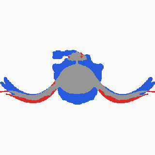

# GPT-6 Luna High, Codex · Swallowtail Orchard

| Measure | Value |
|---|---|
| Model | GPT-6 Luna High, Codex |
| Driver | Codex subscription |
| Effort | high |
| Scope | One fresh model, rig and five animations under a 60,000-triangle cap. 10 evaluated models. |
| Completed | true |
| Evaluations | 10 |
| Runtime seconds | 2923.553929 |
| Driver turns | unknown |
| Prompt tokens | unknown |
| Cached prompt tokens | unknown |
| Cache write tokens | unknown |
| Completion tokens | unknown |
| Reasoning tokens | unknown |
| Model calls | unknown |
| Cost USD (unavailable) | unknown |
| Numeric score | 0.419 |
| Gates passed | 0 |
| Gates total | 0 |

Token counts use the report's provider conventions. Reasoning is included in completion tokens; cache counters are not extra prompt tokens. Estimated cost is not an invoiced charge.

Fin and streamer tips stretch or separate slightly in extreme roll and loop poses. A thin lining seam is visible in the front smile-and-wink view.

[Download selected model](model-01.glb)

