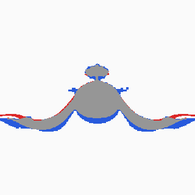

# Gemini 4 Neon High, Antigravity · Fly loop correction

| Measure | Value |
|---|---|
| Model | Gemini 4 Neon High, Antigravity |
| Driver | Antigravity subscription CLI |
| Effort | high |
| Scope | Manual Fly loop repair on the original benchmark export. |
| Completed | true |
| Evaluations | 10 |
| Runtime seconds | unknown |
| Driver turns | unknown |
| Prompt tokens | unknown |
| Cached prompt tokens | unknown |
| Cache write tokens | unknown |
| Completion tokens | unknown |
| Reasoning tokens | unknown |
| Model calls | unknown |
| Cost USD (unavailable) | unknown |
| Numeric score | 0.6922 |
| Gates passed | 0 |
| Gates total | 0 |

Token counts use the report's provider conventions. Reasoning is included in completion tokens; cache counters are not extra prompt tokens. Estimated cost is not an invoiced charge.

The second rig passed the structural checks. Sampled reference views show the feed cavity staying open with the lining attached. Feed still stretches 6.93% of the measured surface. The web export uses core glTF materials.

The Fly seam was manually smoothed after the run.

The frozen modelling scores still describe the original run.

[Download selected model](model-01.glb)

