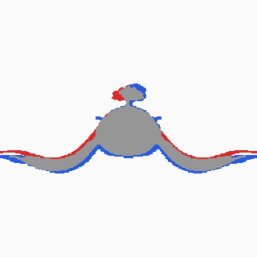

# Opus 5.5 high, Claude Code · Fly pacing correction

| Measure | Value |
|---|---|
| Model | Opus 5.5 high, Claude Code |
| Driver | Claude Code subscription (claude -p) |
| Effort | high |
| Scope | Manual pacing revision of the Fly export. The native benchmark result remains archived. |
| Completed | true |
| Evaluations | 6 |
| Runtime seconds | 4008.0 |
| Driver turns | unknown |
| Prompt tokens | unknown |
| Cached prompt tokens | unknown |
| Cache write tokens | unknown |
| Completion tokens | unknown |
| Reasoning tokens | unknown |
| Model calls | unknown |
| Cost USD (unavailable) | unknown |
| Numeric score | 0.6685 |
| Gates passed | 0 |
| Gates total | 0 |

Token counts use the report's provider conventions. Reasoning is included in completion tokens; cache counters are not extra prompt tokens. Estimated cost is not an invoiced charge.

The feed lining stayed inside the skin at every sampled time with 260 to 273 mm of cavity depth. The belly swell is smooth rather than pleated, a small kink shows in the belly floor, and the fly upstroke twists less than the painting. Fly pacing at the loop boundary was manually adjusted after the run.

[Download selected model](model-01.glb)

