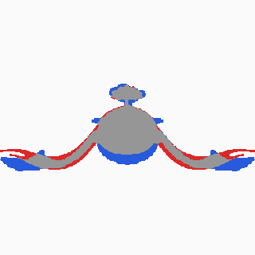

# GPT-6.2 Sol High, Codex · Fly pacing correction

| Measure | Value |
|---|---|
| Model | GPT-6.2 Sol High, Codex |
| Driver | Codex subscription |
| Effort | high |
| Scope | Manual pacing revision of the Fly export. The native benchmark result remains archived. |
| Completed | true |
| Evaluations | 4 |
| Runtime seconds | 2046.0 |
| Driver turns | unknown |
| Prompt tokens | unknown |
| Cached prompt tokens | unknown |
| Cache write tokens | unknown |
| Completion tokens | unknown |
| Reasoning tokens | unknown |
| Model calls | unknown |
| Cost USD (unavailable) | unknown |
| Numeric score | 0.6046 |
| Gates passed | 0 |
| Gates total | 0 |

Token counts use the report's provider conventions. Reasoning is included in completion tokens; cache counters are not extra prompt tokens. Estimated cost is not an invoiced charge.

The continuous feed lining was checked across 73 poses. The garden crown is sparser than the reference and the shoulder root join is visible in profile. The web export uses core glTF materials. Fly pacing at the loop boundary was manually adjusted after the run.

[Download selected model](model-01.glb)

