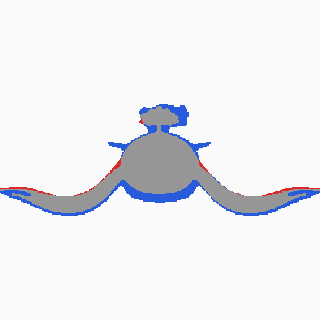

# Sonnet 5.5 high, Claude Code · Swallowtail Orchard

| Measure | Value |
|---|---|
| Model | Sonnet 5.5 high, Claude Code |
| Driver | Claude Code subscription (claude -p) |
| Effort | high |
| Scope | One model, rig and animations, with a 60,000-triangle cap and at most ten evaluated models. |
| Completed | true |
| Evaluations | 4 |
| Runtime seconds | 3714.0 |
| Driver turns | unknown |
| Prompt tokens | unknown |
| Cached prompt tokens | unknown |
| Cache write tokens | unknown |
| Completion tokens | unknown |
| Reasoning tokens | unknown |
| Model calls | unknown |
| Cost USD (unavailable) | unknown |
| Numeric score | 0.6673 |
| Gates passed | 0 |
| Gates total | 0 |

Token counts use the report's provider conventions. Reasoning is included in completion tokens; cache counters are not extra prompt tokens. Estimated cost is not an invoiced charge.

A light model of 21,351 triangles. The feed lining stayed attached in sampled poses, but the cheek lining stretches strongly at full gape. Eyes sit on the cheek silhouette so gaze and wink read weakly head-on, and the garden crown is blockier than the painting.

[Download selected model](model-01.glb)

