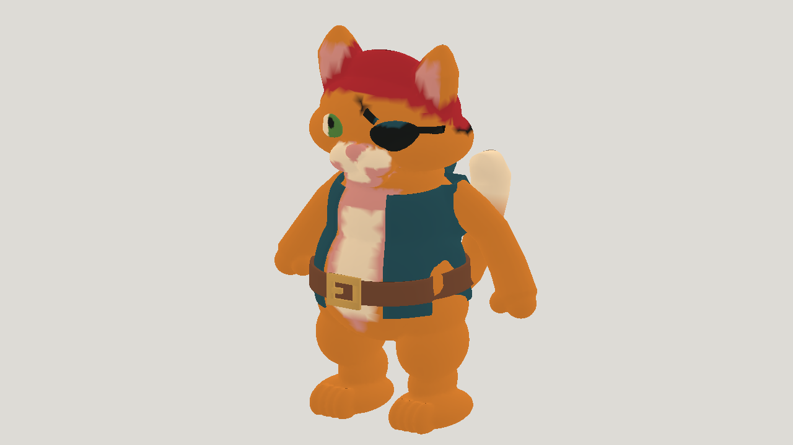

# Gemini 4 Argon High: Pirate cat

| Measure | Value |
|---|---|
| Model | Gemini 4 Argon (High) |
| Driver | agy subscription CLI |
| Effort | high |
| Scope | Five successful static evaluations in one independent run; selected static model and its hero render. Rigging is outside these completed metrics. |
| Completed | true |
| Evaluations | 5 |
| Runtime seconds | unknown |
| Driver turns | unknown |
| Prompt tokens | unknown |
| Cached prompt tokens | unknown |
| Cache write tokens | unknown |
| Completion tokens | unknown |
| Reasoning tokens | unknown |
| Model calls | unknown |
| Cost USD (unavailable) | unknown |
| Numeric score | 0.6874 |
| Gates passed | 19 |
| Gates total | 19 |

Token counts use the report's provider conventions. Reasoning is included in completion tokens; cache counters are not extra prompt tokens. Estimated cost is not an invoiced charge.

Five successful static evaluations; the builder selected a03-refinement, also the numeric leader.

39,616 of 65,000 triangles; 19 of 19 acceptance gates passed.

High effort through agy using an existing subscription; no paid API or API judge.

Numeric scores are contract-specific diagnostics, not finished visual quality or a general model ranking.

Static modeling only; no animated Argon artifact is included. This is an additional Google run, not a claim that it outperforms the earlier Flash selection.

[Download selected model](model-01.glb)
