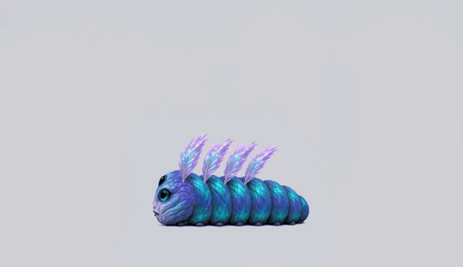
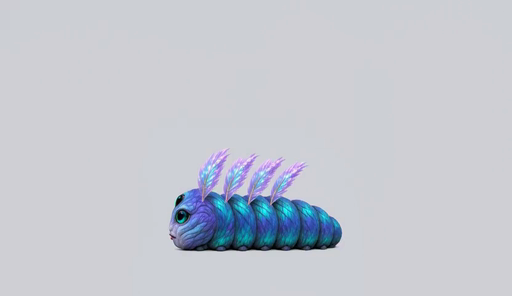

# Caterpillar inch-worm motion reference

| Measure | Value |
|---|---|
| Model | MiniMax H3 motion reference |
| Driver | MiniMax H3 video model |
| Effort | unknown |
| Scope | The approved AI-generated side take, 5.1 s, as a reviewed GIF and still poster. |
| Completed | unknown |
| Evaluations | unknown |
| Runtime seconds | unknown |
| Driver turns | unknown |
| Prompt tokens | unknown |
| Cached prompt tokens | unknown |
| Cache write tokens | unknown |
| Completion tokens | unknown |
| Reasoning tokens | unknown |
| Model calls | unknown |
| Cost USD (unavailable) | unknown |
| Numeric score | unknown |
| Gates passed | unknown |
| Gates total | unknown |

Token counts use the report's provider conventions. Reasoning is included in completion tokens; cache counters are not extra prompt tokens. Estimated cost is not an invoiced charge.

AI-generated inch-worm reference · MiniMax H3 · The side take the Neon rig was written against (it also saw a hero-view take). 5.1 seconds, two strides.

