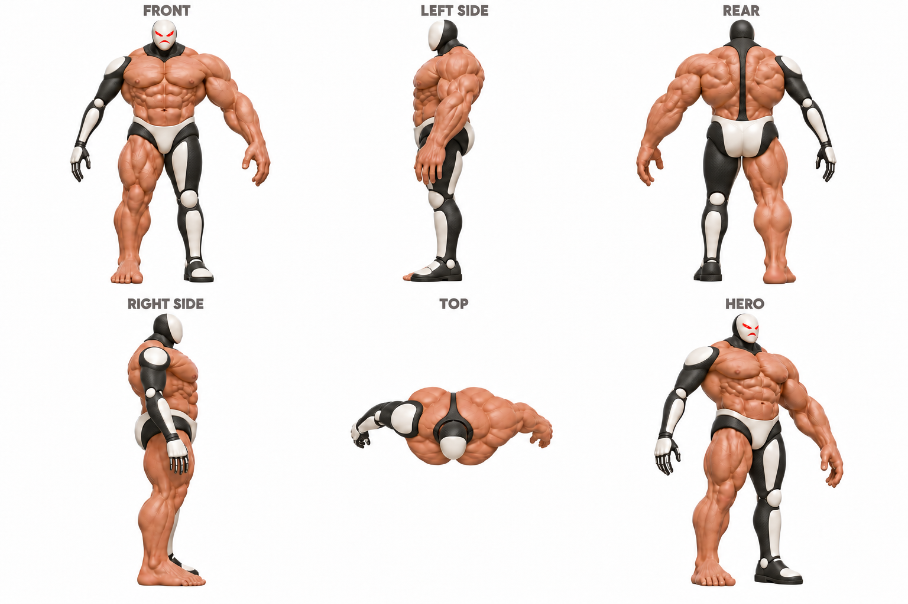
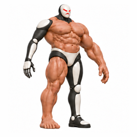

# Official reference: Hulking cyborg

| Measure | Value |
|---|---|
| Model | OpenAI image generation |
| Driver | OpenAI image generation |
| Effort | unknown |
| Scope | Owner-selected six-view cyborg reference |
| Completed | unknown |
| Evaluations | unknown |
| Runtime seconds | unknown |
| Driver turns | unknown |
| Prompt tokens | unknown |
| Cached prompt tokens | unknown |
| Cache write tokens | unknown |
| Completion tokens | unknown |
| Reasoning tokens | unknown |
| Model calls | unknown |
| Cost USD (unavailable) | unknown |
| Numeric score | unknown |
| Gates passed | unknown |
| Gates total | unknown |

Token counts use the report's provider conventions. Reasoning is included in completion tokens; cache counters are not extra prompt tokens. Estimated cost is not an invoiced charge.

Anatomical right arm and left leg are artificial; left arm and right leg are organic. Slim carbon-fibre and ivory ceramic limbs contrast with exaggerated human muscles. White faceplate with luminous eyes and mouth; no chrome.

Raster concept reference, not calibrated views from shared 3D geometry. The reusable modeling contract uses a 60,000-triangle ceiling.

